# Arquitectura

La aplicación es cliente-servidor y está dividida en capas que solo hablan con la vecina: presentación (`public/`), API (`src/api/`), lógica (`src/services/`), datos (`src/repositories/`) e integraciones (`src/integrations/`). El juego (`public/js/game/`) es una capa más de la presentación y comparte sus reglas con el servidor. Las decisiones que llevaron a esta forma están en [decisiones.md](decisiones.md).

## Vista general

Arquitectura **cliente-servidor en capas**. El servidor (Node.js + Express) sirve también el frontend estático, así que todo vive en el mismo origen.

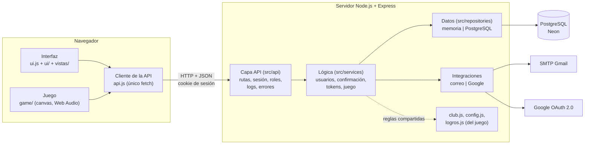

| Capa | Carpeta | Responsabilidad | No hace |
|---|---|---|---|
| Presentación | `public/` | Pintar vistas, validar formularios, mostrar avisos, jugar | No habla con la base de datos ni decide permisos |
| Cliente de la API | `public/js/api.js` | Peticiones HTTP, timeout de 15 s, traducir errores a `ApiError`, avisar si caduca la sesión | No pinta nada |
| API | `src/api/` | Rutas HTTP, sesión, autenticación y autorización, registro de peticiones, formato común de errores | No contiene reglas de negocio |
| Lógica | `src/services/` | Reglas de negocio | No conoce HTTP ni SQL |
| Datos | `src/repositories/` | Guardar y leer (memoria o PostgreSQL) con el mismo contrato | No valida reglas |
| Integraciones | `src/integrations/` | Correo y Google | No decide nada |
| Composición | `src/app.js`, `src/bootstrap.js` | Conectar las capas, elegir la base de datos, migrar, crear el primer administrador | — |

## Diseño detallado

### Backend: módulos

| Módulo | Qué hace |
|---|---|
| `server.js` | Punto de entrada: carga la configuración, llama a `bootstrap` y escucha en `PORT`; para con orden al recibir `SIGTERM` |
| `bootstrap.js` | Elige PostgreSQL (si hay `DATABASE_URL`) o memoria, aplica las migraciones, crea o promociona el primer administrador y crea el correo (SMTP o registro) |
| `app.js` | Construye la app Express: JSON, sesión, `/api` y los estáticos de `public/` |
| `config.js`, `loadConfig.js` | Leen y validan las variables de entorno; en producción exigen los secretos |
| `logger.js` | Logs JSON por línea, con niveles y ocultación de datos sensibles |
| `api/index.js` | Monta el router: `requestLogger`, `currentUser`, `/health`, `/auth`, `/prueba`, `/users` y `/juego` (con `requireAuth`), 404 y manejador de errores |
| `api/auth.js` | Registro, confirmación, reenvío, login, Google, logout y `me` |
| `api/users.js` | Administración de usuarios (`requireRole('admin')`, `requireSelfOrRole('admin')`) |
| `api/juego.js` | Perfil, partidas, contratos, entrenamiento, identidad, ranking y modo pruebas |
| `api/currentUser.js` | Middlewares de identidad, autenticación y autorización |
| `api/errorHandler.js` | Traduce los errores tipados a HTTP (`{ error: { code, message } }`) |
| `services/userService.js` | Reglas de usuarios: registro, autenticación, OAuth, roles, bajas, último administrador y primer administrador |
| `services/accountConfirmationService.js` | Crea y envía el enlace de confirmación, confirma y reenvía |
| `services/tokenSigner.js` | Tokens firmados con HMAC-SHA256 y caducidad |
| `services/passwordHasher.js` | bcrypt (coste 10; en las pruebas, 4) |
| `services/juegoService.js` | Reglas del servidor del juego: perfiles, partidas, validación anti-trampas, recompensas, logros, contratos, entrenamiento, identidad y ranking |
| `services/domainPolicy.js` | Prueba técnica: dominios permitidos |
| `services/errors.js` | Errores tipados: `ValidationError`, `UnauthorizedError`, `ForbiddenError`, `AccountPendingError`, `NotFoundError`, `ConflictError`, `ServiceUnavailableError` |
| `repositories/*` | `memoryUserRepository`, `postgresUserRepository`, `memoryJuegoRepository`, `postgresJuegoRepository` |
| `integrations/mailer.js` | Correo por SMTP (`nodemailer`) o, sin `SMTP_URL`, escrito en el registro |
| `integrations/googleOAuth.js` | URL de autorización de Google e intercambio del código por el perfil |
| `db/migrate.js`, `db/migrations/*.sql` | Migraciones versionadas (001 usuarios, 002 sesiones, 003 juego, 004 identidad, 005 email libre tras la baja) |

### Modelo de datos

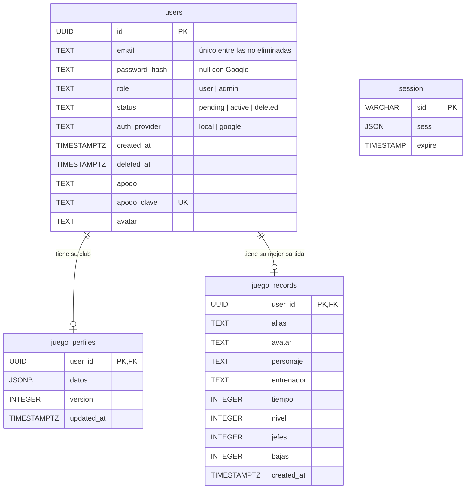

- **`users`**: una fila por cuenta. `email` normalizado (minúsculas, sin espacios) y único **entre las cuentas no eliminadas** (índice parcial de la migración 005), así que tras una baja se puede volver con el mismo email. `password_hash` es nulo en las cuentas de Google. `apodo_clave` es el mote normalizado (sin mayúsculas ni tildes) con índice único.
- **`session`**: la gestiona `connect-pg-simple`. Guarda el `userId` y, durante el acceso con Google, el `state`.
- **`juego_perfiles.datos`** (JSONB): plantilla (`jugadores` con jefes, bajas, partidas y estadísticas de entrenamiento), contadores (`jefesTotal`, `partidas`, `contratos`), logros con su fecha y la partida en curso (`partidaActual`). `version` sube en cada escritura (concurrencia optimista).
- **`juego_records`**: la mejor partida de cada usuario (más tiempo; en empate, más nivel), con el mote y el avatar para el ranking.

**Estados de una cuenta**

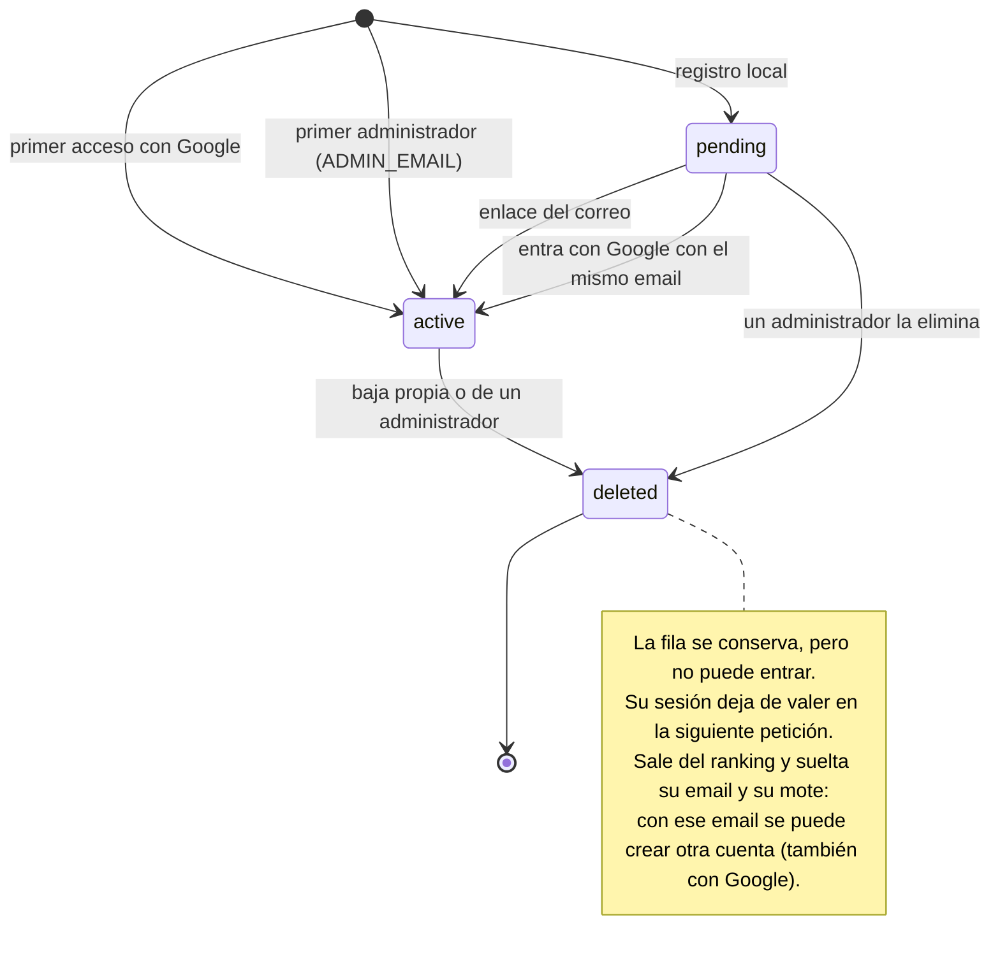

### Frontend

- **SPA con rutas por hash** (`public/js/ui.js`): `#/` inicio, `#/entrar`, `#/registro`, `#/perfil`, `#/jugar` y `#/admin`, y una vista 404 («Fuera de juego»). Cada ruta declara si es protegida, solo para invitados o solo para administradores; la interfaz redirige, pero **la protección real está en el servidor**.
- **Vistas** (`ui/vistas/*.js`): cada una exporta `montar(raiz, contexto)` y devuelve una función de limpieza. Se cargan bajo demanda con `import()`.
- **Estado** (`ui/estado.js`): el usuario actual; la cabecera (`ui/cabecera.js`) se repinta al cambiar (mote, avatar, enlaces según el rol).
- **Formularios** (`ui/formulario.js`): validación al escribir (una vez tocado el campo) y al enviar, errores enlazados con `aria-describedby`, botón «Mostrar contraseña», envío doble bloqueado con una rueda de carga.
- **Avisos** (`ui/avisos.js`): mensajes temporales en una zona `aria-live`; los errores usan `role="alert"`. Los que vienen del servidor por redirección (`?aviso=cuenta-confirmada`, `google-cuenta-creada`…) se leen al cargar y se quitan de la barra de direcciones.
- **Componentes** (`ui/componentes.js`): rueda de carga, estado vacío, estado de error con **Reintentar** y `mensajeDeError`, que traduce cualquier error a un texto legible y lo registra en la consola.
- **Diálogos** (`ui/modal.js`): confirmación accesible con el elemento nativo `<dialog>` (sustituye a `window.confirm`): el foco va al botón seguro, `Esc` cierra y el foco vuelve a donde estaba. Se usa antes de cualquier acción destructiva.
- **Cliente** (`api.js`): único sitio con `fetch`; timeout de 15 s con `AbortController`; convierte las respuestas de error en `ApiError` (estado, código y mensaje); si una petición devuelve `401` con sesión, avisa a la interfaz de que la sesión ha caducado.
- **Sistema de diseño** (`public/css/`): tokens (colores, espacios, radios), base, componentes y vistas; tipografía Plus Jakarta Sans autoalojada; modo oscuro rojiblanco; diseño responsive (la tabla de administración se convierte en tarjetas en el móvil).

### API

La lista completa de rutas, con su acceso y su contrato, está en el [README](../README.md#api). Resumen:

| Grupo | Rutas | Acceso |
|---|---|---|
| Salud | `GET /api/health` | Público |
| Autenticación | `POST register`, `POST login`, `POST logout`, `GET me`, `GET confirm`, `POST resend-confirmation`, `POST forgot-password`, `POST reset-password`, `GET providers`, `GET google`, `GET google/callback` | Público (salvo `me`) |
| Usuarios | `PUT /users/me/password`, `GET /users`, `GET /users/:id/active`, `PATCH /users/:id/role`, `DELETE /users/:id` | Admin (la contraseña y la baja, el propio usuario) |
| Juego | `GET perfil`, `POST partidas`, `POST partidas/:id/fin`, `POST contratar`, `POST entrenar`, `PUT identidad`, `GET ranking`, `POST desbloquear` | Sesión (`desbloquear`, admin) |
| Prueba técnica | `POST /api/prueba/dominio` | Público |

## Flujos con diagramas de secuencia

### Registro con email y contraseña

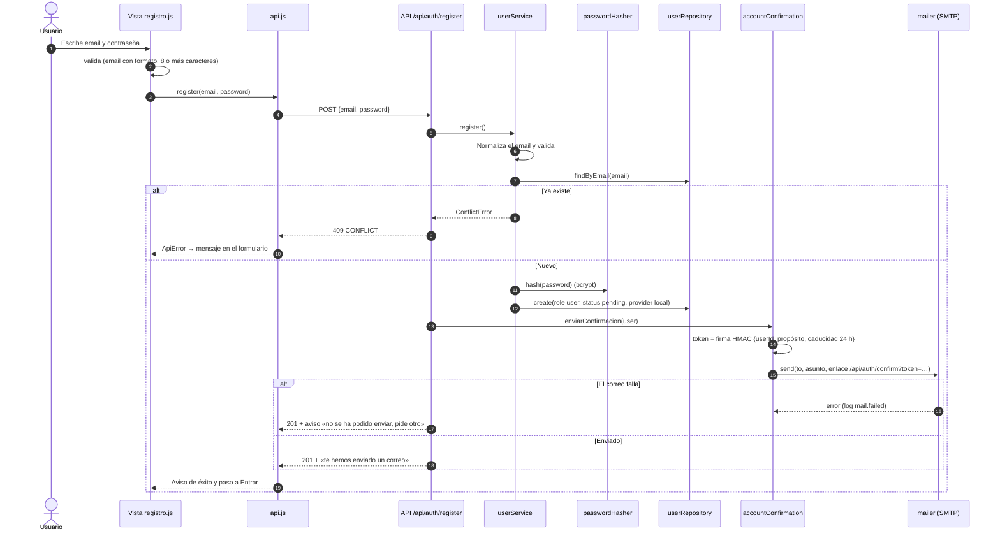

### Confirmación con el enlace del correo

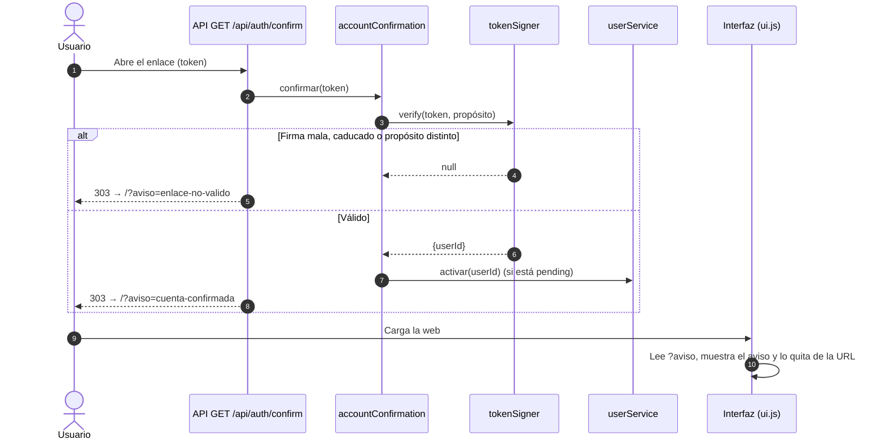

### Inicio de sesión local (incluye cuenta pendiente y reenvío)

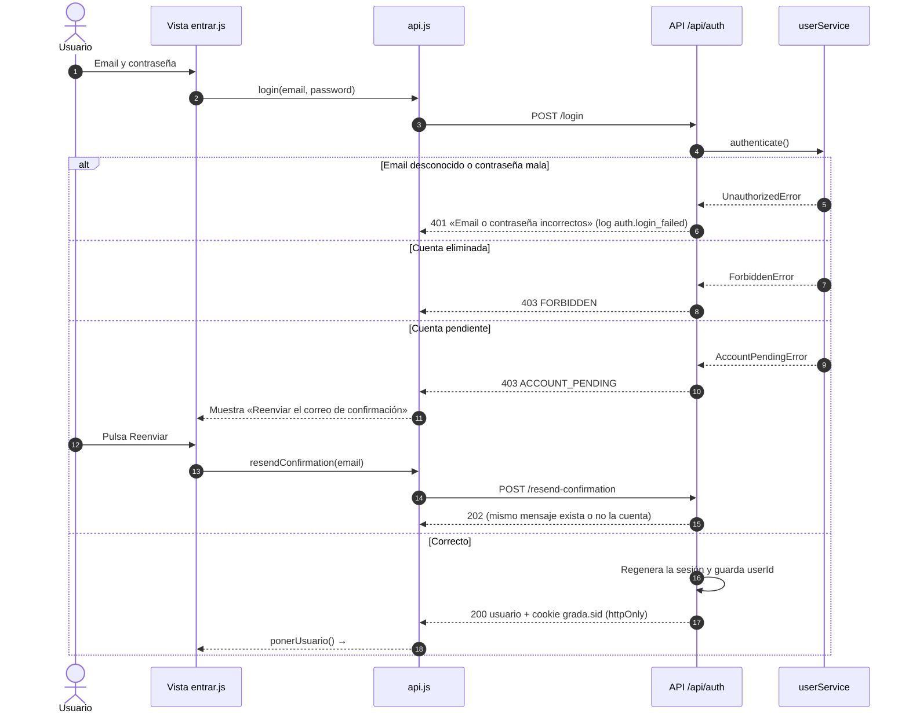

### Inicio de sesión con Google (OAuth 2.0, código de autorización)

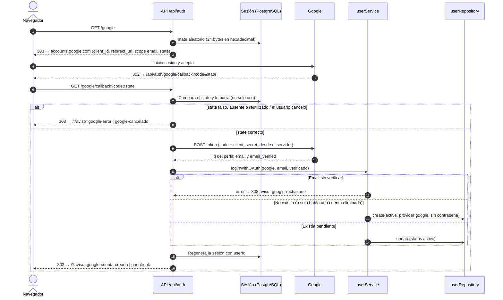

### Recuperar la sesión al recargar y cerrar sesión

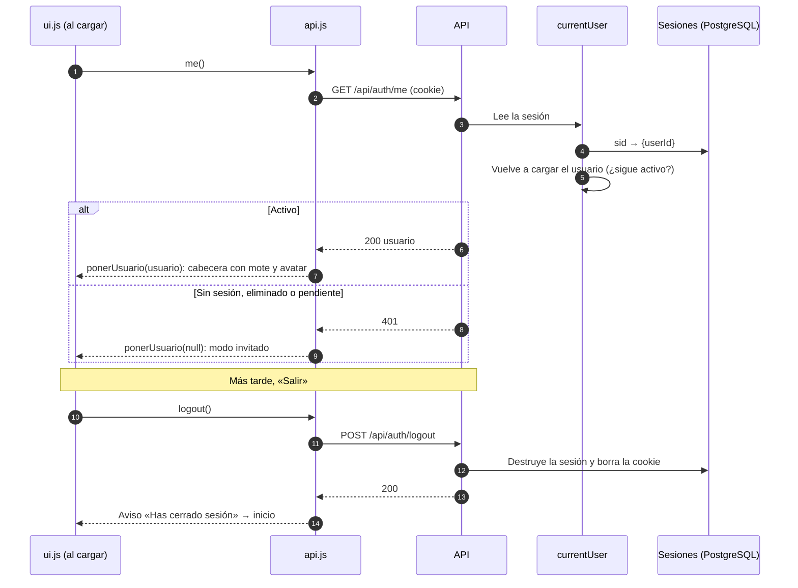

### Petición protegida y autorización por roles

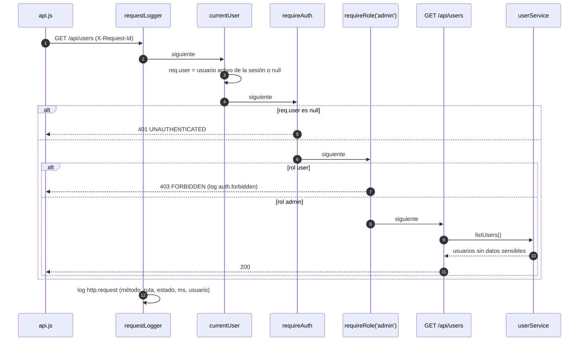

### Cambiar el rol y proteger al último administrador

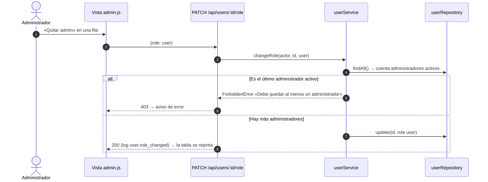

### Darse de baja

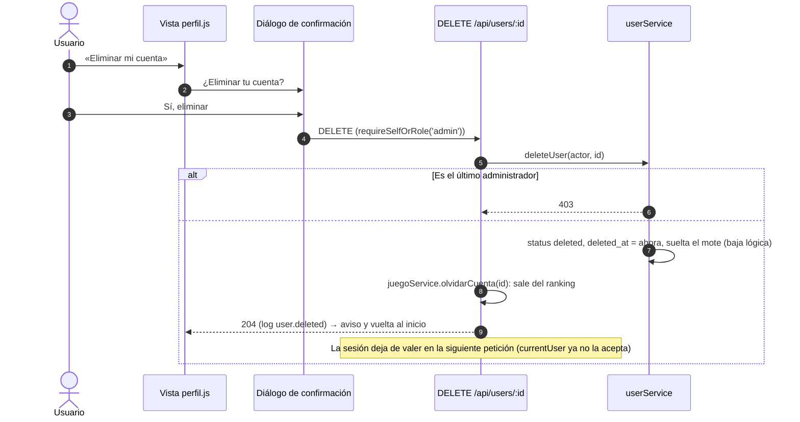

### Arranque: base de datos, migraciones y primer administrador

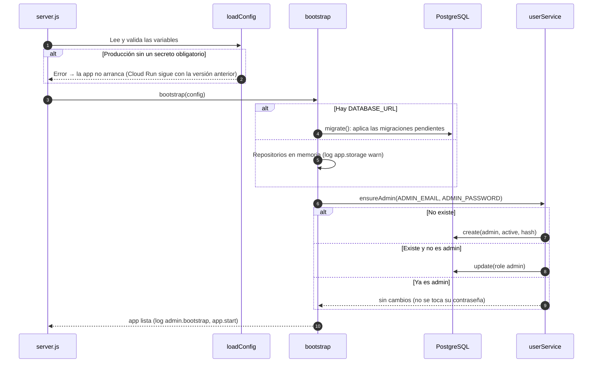

### Una partida del juego (inicio, juego y fin con validación)

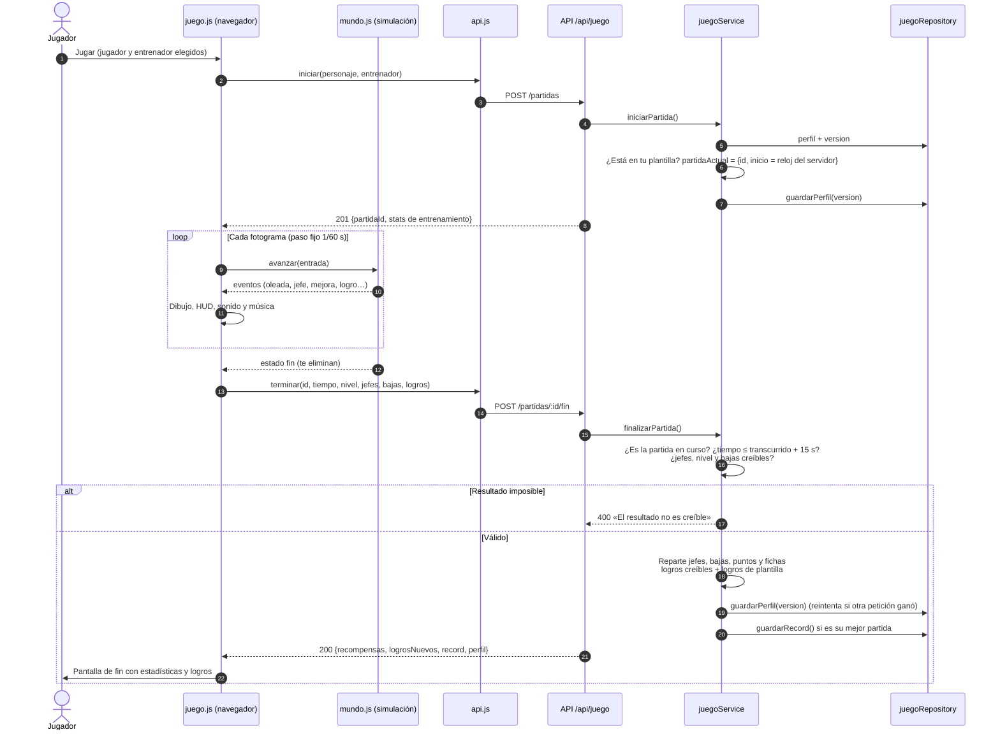

### Contratar con una ficha (concurrencia optimista)

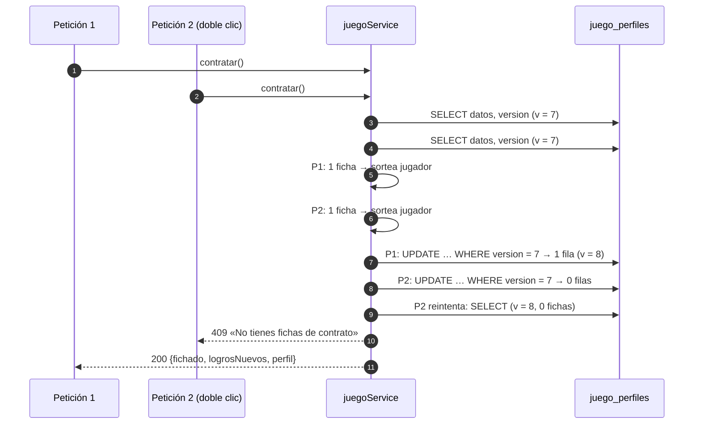

### Integración y despliegue continuos

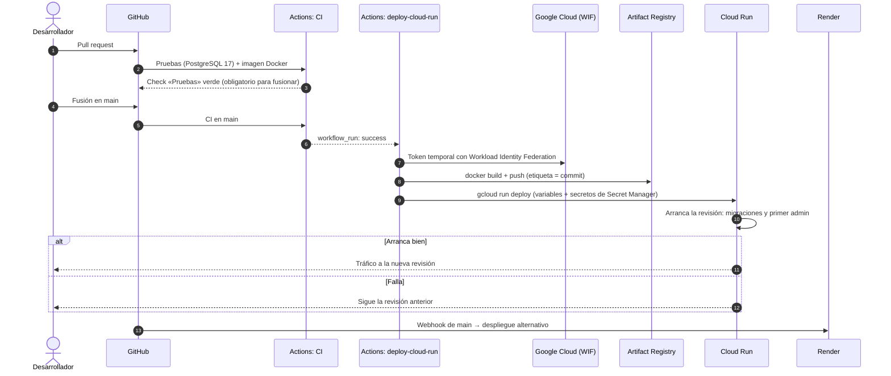

### Prueba técnica: dominio permitido

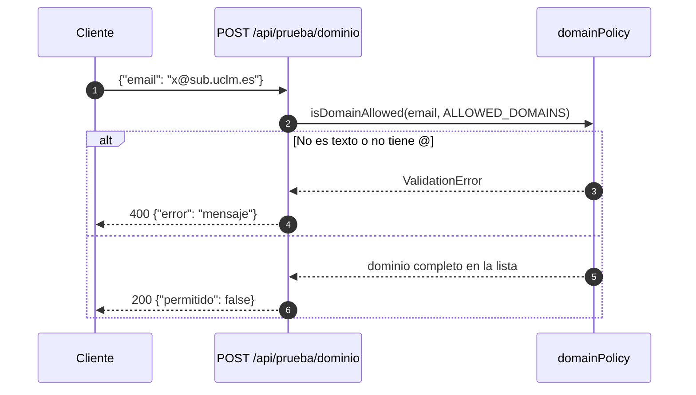

## Seguridad

| Amenaza | Medida | Dónde |
|---|---|---|
| Robo de contraseñas | Solo se guarda el hash **bcrypt** (sal, coste 10). Nunca la contraseña ni un cifrado reversible | `passwordHasher.js` |
| Fuerza bruta / enumeración | El mismo mensaje si el email no existe o la contraseña es incorrecta; el reenvío responde igual exista o no la cuenta; los intentos fallidos se registran con IP | `userService.js`, `auth.js` |
| Robo o fijación de sesión | Cookie `httpOnly`, `sameSite=lax`, `secure` en producción; la sesión se **regenera** al entrar y se destruye al salir; las sesiones se guardan en el servidor | `app.js`, `auth.js` |
| Sesión de una cuenta eliminada | En cada petición se vuelve a cargar el usuario; si ya no está activo, la sesión deja de valer | `currentUser.js` |
| Escalada de privilegios | Roles comprobados en el servidor (`401`/`403`); la interfaz solo oculta; siempre queda un administrador | `currentUser.js`, `userService.js` |
| Enlaces falsificados | Token HMAC-SHA256 con clave derivada, comparación en tiempo constante, propósito y caducidad (24 h) | `tokenSigner.js` |
| CSRF en OAuth | `state` aleatorio, guardado en la sesión, de un solo uso | `auth.js` |
| Robo del secreto de Google | El código se cambia por el perfil en el servidor; el `client_secret` nunca llega al navegador; solo se acepta un email verificado | `googleOAuth.js` |
| Inyección SQL | Consultas parametrizadas | `postgres*Repository.js` |
| XSS | El DOM se crea con `textContent` (helper `h()`); una prueba lo comprueba; los correos escapan el HTML | `dom.js`, `frontend.test.js`, `accountConfirmationService.js` |
| Secretos expuestos | Solo variables de entorno; Secret Manager con una cuenta de servicio de mínimo privilegio; `.env` ignorado; GitHub accede a Google Cloud sin claves (WIF) | `loadConfig.js`, workflows |
| Datos sensibles en logs | Contraseñas, hashes, cookies, tokens y secretos se sustituyen por `[oculto]` | `logger.js` |
| Trampas en el juego | Reloj del servidor, límites creíbles, logros verificables, concurrencia optimista | `juegoService.js` |
| Privacidad | Política de privacidad pública; el ranking no muestra correos | `privacidad.html`, `juegoService.ranking` |

## Arquitectura del juego

### Arquitectura del juego

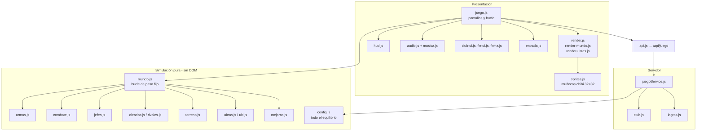

- **Determinismo.** `mundo.js` avanza con un paso fijo de 1/60 s y un generador aleatorio con semilla. Si el navegador va lento, se hacen varios pasos por fotograma (con un tope); el resultado no depende de los FPS y las pruebas son reproducibles.
- **Eventos.** La simulación no toca el DOM ni el audio: deja eventos (`oleada`, `aviso`, `jefe-derrotado`, `ambiente`, `ultra`…) que `juego.js` traduce a sonido, avisos y anuncios para lectores de pantalla.
- **Estadísticas.** Cada fuente de daño (arma, ultra, ulti, quemaduras) se apunta en `mundo.stats` para la pantalla de fin.
- **Rendimiento.** Búsqueda de obstáculos por celdas con claves numéricas (unas 4,5 veces más rápida que la primera versión), una textura de suelo por celda y ambiente, pintada como mucho una por fotograma y por adelantado, y muñecos cacheados.
- **Dibujo.** Canvas 2D con cámara 3/4 (el suelo se aplasta en vertical y los muñecos están de pie). Los muñecos se pintan con código en una cuadrícula de 32×32 en estilo chibi (16×20 con piernas hasta la Fase 6): cabeza grande, cuerpo y zapatones, sin piernas. Se pintan por capas y píxel a píxel: zapatos, pantalón, torso, brazos y cabeza, cada una con su contorno de color y luz desde arriba a la izquierda. Cada persona tiene sus rasgos (18 peinados, 6 tipos de barba, mandíbula, complexión, estatura, gesto, gafas, cinta, guantes, brazalete…) y caminan con 4 fotogramas. Así se generan las equipaciones y las camisetas de 26 selecciones sin imágenes. El mapa (Fase 7) se pinta con píxeles de 2 unidades en `render-suelo.js` y `render-obstaculos.js`, con las paletas de cada ambiente en `render-paletas.js`, y los efectos de las habilidades en `render-habilidades.js` (partículas con tope y azar propio en `efectos.js`, para que encenderlas o apagarlas no cambie la partida).
- **Audio.** Todo sintetizado con Web Audio: ondas de pulso (12,5 %, 25 % y 50 %), triángulo y ruido. La música es un secuenciador propio que programa las notas por adelantado; la grada usa voces con formantes de vocales y palmas.

### Servidor del juego y anti-trampas

- Al **empezar**, el servidor guarda la partida en curso con su propio reloj.
- Al **terminar**, rechaza el resultado si la partida no es la que está en curso, si el tiempo supera lo transcurrido (con 15 s de margen) o 4 horas, o si los jefes, el nivel o las bajas no son creíbles para ese tiempo (`jefes ≤ 3 + t/50`, `nivel ≤ 8 + t/3`, `bajas ≤ 20·t + 50`).
- De los **logros** que manda el cliente, solo apunta los que puede comprobar con lo que sabe (tiempo, jefes, bajas, jugador y entrenador); los de plantilla los calcula él.
- Cada cambio del perfil usa **concurrencia optimista** (`UPDATE … WHERE version = $n`) con reintentos.
- El **ranking** guarda la mejor partida de cada usuario con su mote y avatar, nunca el correo.

## Registro de actividad y manejo de errores

### Logs

Una línea JSON por evento en la salida estándar (Cloud Logging en producción), con `time`, `level`, `event`, `msg` y datos, por ejemplo `{"time":"2026-10-12T10:00:00.000Z","level":"info","event":"auth.login","msg":"Inicio de sesión","userId":"..."}`. Cada petición lleva un identificador (`X-Request-Id`) que aparece en todas sus líneas. Eventos: `app.start`, `app.stop`, `app.storage`, `app.mail`, `admin.bootstrap`, `http.request`, `http.error`, `user.registered`, `auth.login`, `auth.logout`, `auth.login_failed`, `auth.forbidden`, `mail.confirmation_sent`, `mail.failed`, `mail.not_sent`, `user.confirmed`, `user.confirm_failed`, `auth.oauth_denied`, `auth.oauth_failed`, `user.role_changed`, `user.deleted` y `juego.identidad`. Los datos sensibles se sustituyen por `[oculto]`.

### Errores de principio a fin

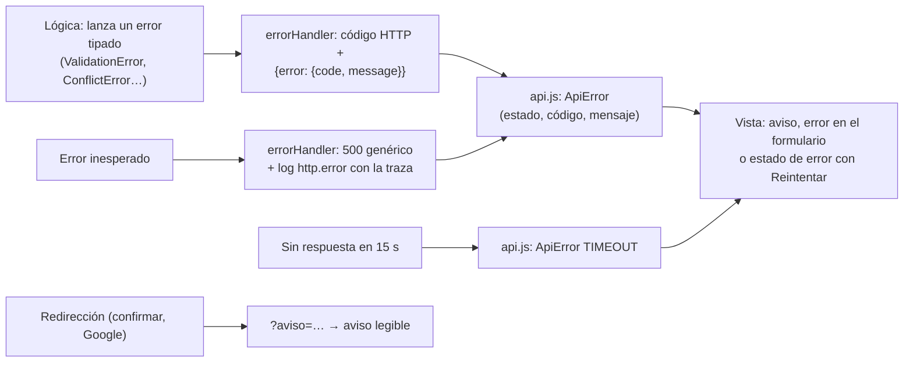

- El usuario nunca ve JSON ni trazas: cada error se traduce a un mensaje en español.
- La interfaz tiene estados de **carga**, **vacío** y **error con reintento**, y una captura global de promesas rechazadas.
- Los formularios marcan el campo con el error y lo explican debajo; al fallar el servidor, el formulario muestra el error arriba sin perder lo escrito (salvo la contraseña).
