# La Grada Colchonera: documentación técnica

Documento de referencia del proyecto, pensado como **base para escribir la memoria** (planteada como un TFG). Reúne en un solo sitio el qué, el cómo y el porqué: requisitos, gestión, decisiones de diseño, arquitectura, flujos con diagramas de secuencia, seguridad, pruebas, despliegue, el juego, problemas encontrados y métricas. Todo lo que se cuenta aquí está en el repositorio y se puede comprobar en el código, en los pull requests o en las capturas.

| | |
|---|---|
| **Proyecto** | La Grada Colchonera: juego web rojiblanco tipo *survivor* en pixel art sobre una aplicación SaaS en capas |
| **Asignatura** | Procesos de Ingeniería del Software (PIS), curso 2026-2027. Proyecto individual planteado como un TFG |
| **Autor** | Javier Vela |
| **Repositorio** | https://github.com/VelaElDios/la-grada-colchonera-saas |
| **Aplicación** | https://la-grada-colchonera-1081564062572.europe-southwest1.run.app (Google Cloud Run) |
| **Sprint 1** | 29/09/2026 – 27/10/2026 (Hitos 1 a 4) |
| **Estado del documento** | 27/10/2026, versión con el juego hasta la Fase 6 |

## Índice

1. [Cómo usar este documento para la memoria](#1-cómo-usar-este-documento-para-la-memoria)
2. [Contexto, objetivos y alcance](#2-contexto-objetivos-y-alcance)
3. [Requisitos](#3-requisitos)
4. [Metodología y gestión del proyecto](#4-metodología-y-gestión-del-proyecto)
5. [Arquitectura y decisiones de diseño](#5-arquitectura-y-decisiones-de-diseño)
6. [Diseño detallado](#6-diseño-detallado)
7. [Flujos con diagramas de secuencia](#7-flujos-con-diagramas-de-secuencia)
8. [Seguridad](#8-seguridad)
9. [El juego](#9-el-juego)
10. [Pruebas](#10-pruebas)
11. [Integración y despliegue continuos](#11-integración-y-despliegue-continuos)
12. [Registro de actividad y manejo de errores](#12-registro-de-actividad-y-manejo-de-errores)
13. [Problemas encontrados y cómo se resolvieron](#13-problemas-encontrados-y-cómo-se-resolvieron)
14. [Métricas del proyecto](#14-métricas-del-proyecto)
15. [Conclusiones y trabajo futuro](#15-conclusiones-y-trabajo-futuro)
16. [Índice de capturas](#16-índice-de-capturas)
17. [Glosario](#17-glosario)

---

## 1. Cómo usar este documento para la memoria

La memoria está en [`memoria/`](../memoria/README.md) (LuaLaTeX, estilo TFG) y ya tiene sus capítulos creados. Esta tabla dice qué secciones de este documento alimentan cada capítulo:

| Capítulo de la memoria | Fichero | Secciones de este documento |
|---|---|---|
| Resumen / abstract | `preliminares/resumen.tex` | 2, 14 y 15 |
| 1. Introducción | `capitulos/01-introduccion.tex` | 2 y 3 |
| 2. Gestión del proyecto | `capitulos/02-gestion.tex` | 4 (y [`docs/gestion/README.md`](gestion/README.md)) |
| 3. Arquitectura | `capitulos/03-arquitectura.tex` | 5 y 6.1–6.3 |
| 4. Implementación | `capitulos/04-implementacion.tex` | 6, 7, 8 y 9 |
| 5. Pruebas, errores y logs | `capitulos/05-pruebas.tex` | 10 y 12 |
| 6. CI/CD | `capitulos/06-cicd.tex` | 11 |
| 7. Conclusiones | `capitulos/07-conclusiones.tex` | 13, 14 y 15 |
| Anexo A. Manual de usuario | `anexos/A-manual-usuario.tex` | 9.2 y 16 (capturas) |
| Anexo B. Trazabilidad | `anexos/B-trazabilidad.tex` | 3 y 4.4 |

- **Diagramas.** Todos los diagramas de este documento están en Mermaid. Para la memoria se pueden exportar a PDF o PNG con la CLI de Mermaid (`npx @mermaid-js/mermaid-cli -i diagrama.mmd -o diagrama.pdf`) y guardarlos en `memoria/figuras/`.
- **Capturas.** `\graphicspath` de `memoria/main.tex` ya busca en `docs/capturas/app/`, `docs/capturas/hito4/` y `docs/capturas/produccion/`, así que basta con `\includegraphics{07-panel-admin}`. La lista completa, con lo que muestra cada una, está en la [sección 16](#16-índice-de-capturas).
- **Cambio de enfoque.** El proyecto empezó como una red social para aficionados del Atlético y acabó siendo un **juego**. Los hitos del Sprint 1 no dependen de esa decisión (son la base SaaS: cuentas, sesión, roles, datos, despliegue), y el juego se ha construido encima después. En la memoria conviene contarlo como un cambio de alcance justificado (sección 2.3).

## 2. Contexto, objetivos y alcance

### 2.1 Contexto

El trabajo de PIS se plantea como si fuera un TFG: un producto software real, desarrollado con un proceso de ingeniería (Scrum, control de versiones, integración y despliegue continuos, pruebas automáticas) y documentado con una memoria. El enunciado del Sprint 1 fija cuatro hitos comunes a todos los proyectos, centrados en la base de cualquier aplicación SaaS: gestión de usuarios, autenticación, persistencia, roles, seguridad y despliegue.

### 2.2 Objetivos

1. **Producto:** una aplicación web pública en la que los aficionados del Atlético de Madrid se registran, entran (con email o con Google) y juegan a un juego propio, con su progreso guardado en el servidor.
2. **Proceso:** aplicar Scrum con un backlog en DoneTonic, GitHub Flow con una rama y un pull request por tarea, integración continua con pruebas automáticas y despliegue continuo en la nube.
3. **Calidad:** arquitectura en capas con responsabilidades separadas, pruebas de los casos de error (no solo del camino feliz), seguridad desde el diseño (hash de contraseñas, secretos fuera del código, permisos en el servidor) y una interfaz accesible y responsive.
4. **Documentación:** que todo el trabajo, incluida la gestión, se pueda revisar desde el repositorio (README, `docs/` y memoria).

### 2.3 Alcance y cambio de enfoque

| Etapa | Alcance |
|---|---|
| **Sprint 1, Hitos 1–3** (29/09 – 12/10/2026) | Repositorio, CI, despliegue continuo, lógica de usuarios con pruebas, API REST, frontend separado en interfaz y cliente, registro e inicio de sesión locales, sesión, rutas protegidas, PostgreSQL, secretos, roles, panel de administración y logs |
| **Sprint 1, Hito 4** (hasta el 23/10/2026) | Confirmación de cuenta por correo, inicio de sesión con Google, manejo de errores de principio a fin, política de privacidad y aplicación de Google publicada |
| **Cierre del sprint** (24/10/2026) | README, capturas, revisión de la entrega frente al enunciado, despliegue en Google Cloud Run y estructura de la memoria |
| **Después del sprint** (octubre de 2026) | Rediseño de la interfaz y el juego, en seis fases |

**Por qué un juego y no una red social.** La idea inicial era una red social tipo Twitter para aficionados del Atleti. Cerrado el Sprint 1, el profesor dejó libertad para la lógica y el diseño del producto, y se decidió hacer un juego porque: (1) es más original y diferenciador que otro clon de red social; (2) permite trabajar problemas técnicos más ricos (simulación determinista, rendimiento en canvas, generación procedural, sonido sintetizado, validación anti-trampas en el servidor); y (3) reutiliza entera la base SaaS del sprint: un juego con cuentas, progreso en el servidor, ranking y roles necesita exactamente lo que piden los hitos.

**Fuera de alcance (por ahora):** multijugador en tiempo real, amigos y partidas en grupo, y aplicaciones nativas (ver la [sección 15](#15-conclusiones-y-trabajo-futuro)).

## 3. Requisitos

### 3.1 Requisitos funcionales del Sprint 1

| Id | Requisito | Hito | PBI | Dónde se cumple | Pruebas |
|---|---|---|---|---|---|
| RF-01 | Registro con email y contraseña (validación, email único, contraseña de 8 o más caracteres) | 2 | P8 | `userService.register`, `POST /api/auth/register`, vista `registro.js` | `userService`, `api.auth` |
| RF-02 | Inicio de sesión local, con el mismo mensaje si el email no existe o la contraseña es incorrecta | 2 | P8 | `userService.authenticate`, `POST /api/auth/login` | `api.auth` |
| RF-03 | Mantener la sesión al recargar y cerrarla en el servidor | 2 | P9 | `express-session` + tabla `session`, `GET /api/auth/me`, `POST /api/auth/logout` | `api.auth`, `api.database` (CI) |
| RF-04 | Rutas protegidas en el servidor (`401` sin sesión) | 2 | P10 | `requireAuth` | `api.users`, `api.auth` |
| RF-05 | Persistencia en una base de datos real | 3 | P11 | PostgreSQL (Neon), `postgresUserRepository`, migraciones | `userRepository`, `migrate`, `api.database` |
| RF-06 | Roles usuario y administrador, con un primer administrador | 3 | P13 | `requireRole`, `requireSelfOrRole`, `userService.ensureAdmin` | `userService`, `api.users`, `bootstrap` |
| RF-07 | Listar usuarios, ver si un usuario está activo y cambiar roles (solo administrador) | 3 | P13 | `GET /api/users`, `GET /api/users/:id/active`, `PATCH /api/users/:id/role`, vista `admin.js` | `api.users` |
| RF-08 | Darse de baja (y que el administrador pueda eliminar cuentas); nunca eliminar al último administrador; tras la baja se puede volver con el mismo email | 3 | P13 | `DELETE /api/users/:id` (baja lógica), vistas `perfil.js` y `admin.js` | `userService`, `api.users` |
| RF-09 | Registro de la actividad relevante | 3 | P14 | `src/logger.js`, `requestLogger` | `logger` |
| RF-10 | Confirmación de la cuenta por correo, con reenvío | 4 | P16 | `accountConfirmationService`, `tokenSigner`, `mailer`, `GET /api/auth/confirm`, `POST /api/auth/resend-confirmation` | `accountConfirmation`, `tokenSigner`, `mailer`, `api.auth` |
| RF-11 | Inicio de sesión con un proveedor externo (Google, OAuth 2.0) | 4 | P15 | `googleOAuth.js`, `GET /api/auth/google`, `GET /api/auth/google/callback`, `userService.loginWithOAuth` | `googleOAuth`, `userService` |
| RF-12 | Manejo de errores con información clara al usuario | 4 | P17 | `errorHandler.js`, `componentes.js`, `avisos.js`, `api.js` (timeout) | `api.*`, `frontend` |
| RF-13 | Prueba técnica: solo dominios de correo permitidos | Prueba | — | `domainPolicy.js`, `POST /api/prueba/dominio` | `domainPolicy` (13) |

### 3.2 Requisitos funcionales del juego

| Id | Requisito | Dónde se cumple |
|---|---|---|
| RJ-01 | Solo juegan los usuarios con sesión; el progreso va ligado a la cuenta | `requireAuth` en `/api/juego`, tablas `juego_perfiles` y `juego_records` |
| RJ-02 | Partida *survivor* infinita con oleadas, jefes, mejoras al subir de nivel y dificultad creciente | `public/js/game/mundo.js` y módulos de la simulación |
| RJ-03 | Elegir jugador (36, con rareza) y entrenador (2) | Vestuario y Dirección (`juego.js`), `config.js` |
| RJ-04 | Club: fichas de contrato, fichajes y entrenamiento | `club.js`, `POST /api/juego/contratar`, `POST /api/juego/entrenar` |
| RJ-05 | Ranking de la grada con la mejor partida de cada usuario | `juego_records`, `GET /api/juego/ranking` |
| RJ-06 | Mote único y avatar | `PUT /api/juego/identidad`, migración `004` |
| RJ-07 | Resultados y logros validados en el servidor (anti-trampas) | `juegoService.finalizarPartida`, `logros.js` |
| RJ-08 | Logros con datos de la historia del Atleti y equipaciones desbloqueables | `logros.js`, `fin-ui.js` |
| RJ-09 | Sonido y música propios, con ajustes de volumen | `audio.js`, `musica.js`, `ajustes.js` |
| RJ-10 | Jugable con teclado, ratón y pantalla táctil | `entrada.js` (joystick táctil) |
| RJ-11 | Modo pruebas para administradores | `POST /api/juego/desbloquear`, `scripts/desbloquear-juego.js` |

### 3.3 Requisitos no funcionales

| Id | Requisito | Cómo se cumple |
|---|---|---|
| RNF-01 | **Seguridad** de credenciales y sesiones | Hash bcrypt, cookie `httpOnly` + `secure` + `sameSite`, regeneración de la sesión, permisos en el servidor, consultas parametrizadas (sección 8) |
| RNF-02 | **Secretos fuera del código** | Variables de entorno; Secret Manager en producción; la app no arranca si falta un secreto obligatorio |
| RNF-03 | **Separación en capas** | API → lógica → datos/integraciones, con inyección de dependencias (sección 5) |
| RNF-04 | **Pruebas automáticas** y CI obligatorio | 276 pruebas con `node:test`; las ramas protegidas exigen el CI en verde |
| RNF-05 | **Despliegue continuo** en una URL pública | Cloud Run (principal) y Render (alternativo), sin intervención manual |
| RNF-06 | **Disponibilidad y coste** | Escala a cero (capas gratuitas y créditos de educación); si una versión no arranca, sigue sirviendo la anterior |
| RNF-07 | **Accesibilidad** | HTML semántico, foco gestionado al navegar, `aria-live` en los avisos, errores de formulario enlazados con `aria-describedby`, manejo con teclado, `prefers-reduced-motion` |
| RNF-08 | **Responsive** | Diseño adaptable: el panel de administración pasa a tarjetas en el móvil; joystick táctil en el juego |
| RNF-09 | **Rendimiento del juego** | 60 FPS en un portátil normal: simulación de paso fijo, búsqueda espacial por celdas, texturas por celda cacheadas y precargadas |
| RNF-10 | **Trazabilidad** | Requisito → PBI → tarea → rama → PR → release (sección 4.4) |
| RNF-11 | **Privacidad** | Política de privacidad pública; el ranking nunca muestra el correo; los logs ocultan los datos sensibles |
| RNF-12 | **Mantenibilidad** | Sin frameworks ni compilación en el frontend; todo el equilibrio del juego en un fichero de configuración; módulos pequeños y comentados |

## 4. Metodología y gestión del proyecto

### 4.1 Scrum con DoneTonic

- **Herramienta:** DoneTonic, espacio de trabajo *TFG*, equipo *Colchoneros*.
- **Sprint 1:** del 29/09/2026 al 27/10/2026.
- **Product Backlog:** 19 PBIs (P1–P19) con 32 tareas (T1–T32), etiquetados por hito (H1–H4). Todos son **MUST** porque son requisitos obligatorios del enunciado.
- **Del enunciado al backlog:** cada requisito se convirtió en un PBI con descripción y criterios de aceptación; cada PBI se dividió en una o dos tareas; cada tarea es una rama y un PR.
- **Seguimiento:** tablero por estados, Sprint Burnup y Burndown, Backlog Burndown y Burnup y Velocity Chart (capturas en `docs/capturas/donetonic/`).
- **Cambio de alcance durante el sprint:** el profesor repartió créditos de Google Cloud para educación y se añadió el PBI **P19** (despliegue en Google Cloud Run, tareas T29 y T30). Render se mantiene como despliegue alternativo.

### 4.2 Definición de hecho (DoD)

Una **tarea** está hecha cuando su código está en su rama y en un PR con la referencia a la tarea, las pruebas pasan en el CI (check **Pruebas**), el PR está fusionado en la rama del hito y la documentación (README, `.env.example`) está actualizada si hace falta. Un **hito** está hecho cuando su rama está en `main`, desplegada en la URL pública y publicada como release.

### 4.3 GitHub Flow por hitos

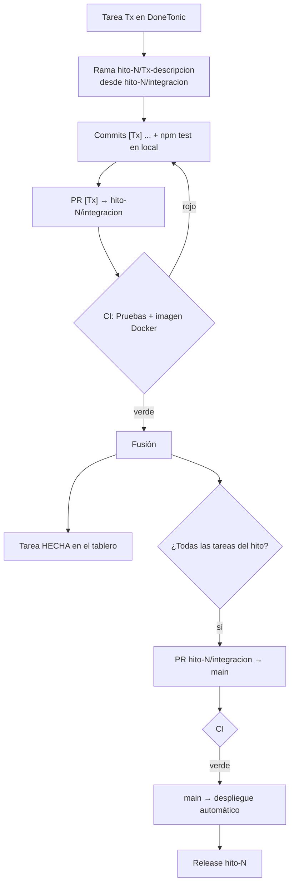

- `main` y `hito-*/integracion` están **protegidas**: solo admiten cambios por PR y exigen el CI en verde.
- Commits en español, en imperativo y con el identificador de la tarea (`[T5] Añade el repositorio de usuarios en memoria`), según [`CONTRIBUTING.md`](../CONTRIBUTING.md).
- **Hito 4:** una rama por tarea (`hito-4/T22-google-oauth`, `T23-correo`, `T24-confirmacion`, `T25-secretos-hito4`, `T26-privacidad`) integrada directamente en `main` con su PR (#37–#41). Como dependían unas de otras, se reubicaron (rebase) sobre el `main` real antes de abrir los PRs.
- **Juego:** ramas `feature/rediseno-y-juego`, `juego/personajes-pixel` y `juego/movilidad-hub`, con un PR a `main` por fase (por ejemplo, #53 para la Fase 5 y #54 para la Fase 6).

### 4.4 Backlog, trazabilidad y entregas

| PBI | Hito | Título | Tareas | PRs | Release |
|---|---|---|---|---|---|
| P1 | H1 | Repositorio GitHub y flujo GitHub Flow | T1, T2 | #1, #2 | hito-1 |
| P2 | H1 | Integración continua (CI) | T3 | #3 | hito-1 |
| P3 | H1 | Despliegue continuo en URL pública | T4 | #4, #10 | hito-1 |
| P4 | H1 | Lógica de gestión de usuarios (en memoria) | T5, T6 | #5, #6 | hito-1 |
| P5 | H1 | Pruebas unitarias automatizadas de la lógica | T7 | #7 | hito-1 |
| P6 | H1 | Capa API de usuarios | T8 | #8 | hito-1 |
| P7 | H2 | Frontend: interfaz y cliente de comunicación separados | T9, T10 | #11, #12 | hito-2 |
| P8 | H2 | Registro e inicio de sesión locales | T11, T12 | #13, #14 | hito-2 |
| P9 | H2 | Cierre de sesión y mantenimiento de la sesión | T13 | #15 | hito-2 |
| P10 | H2 | Rutas protegidas en el servidor | T14 | #16 | hito-2 |
| P11 | H3 | Persistencia en base de datos real | T15, T16 | #18, #19 | hito-3 |
| P12 | H3 | Gestión de secretos con variables de entorno | T17 | #20 | hito-3 |
| P13 | H3 | Roles de usuario y administrador | T18, T19 | #21, #22 | hito-3 |
| P14 | H3 | Registro (log) de la actividad | T20 | #23 | hito-3 |
| P15 | H4 | Inicio de sesión con proveedor externo (OAuth) | T22 | #40 | hito-4 |
| P16 | H4 | Confirmación de cuenta por correo electrónico | T23, T24 | #38, #39 | hito-4 |
| P17 | H4 | Manejo de errores y feedback al usuario | T22–T26 | #37–#41 | hito-4 |
| P18 | H4 | README completo y revisión de la entrega | T27, T28, T31, T32 | #25, #26, #30, #31 | sprint-1 |
| P19 | H4 | Despliegue continuo en Google Cloud Run | T29, T30 | #27, #28 | sprint-1 |

Cierres de hito: #9 (Hito 1), #17 (Hito 2), #24 (Hito 3), #29 (cierre del sprint) y #32 (revisión final y memoria). La trazabilidad completa, con el nombre de cada rama, está en [`docs/gestion/README.md`](gestion/README.md).

### 4.5 Evolución del sprint

| Momento | PBIs hechos | PBIs pendientes (alcance de la entrega) |
|---|---|---|
| Inicio del Sprint 1 (29/09/2026) | 0 | 15 |
| Cierre del Hito 1 | 6 | 9 |
| Cierre del Hito 2 | 10 | 5 |
| Cierre del Hito 3 | 14 | 1 |
| Se añade P19 (Cloud Run) | 14 | 2 |
| Cierre de la primera entrega (12/10/2026) | 16 | 0 (P15–P17 quedan para después) |
| Hito 4 completado (23/10/2026) | 19 | 0 |

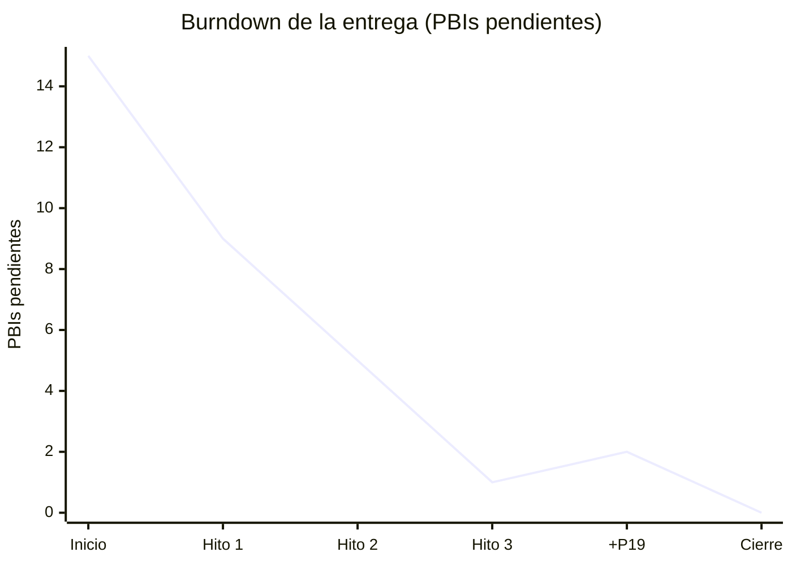

### 4.6 Cronología

| Fecha | Hito |
|---|---|
| 29/09/2026 | Empieza el Sprint 1 |
| Primeras semanas | Hitos 1, 2 y 3 (releases `hito-1`, `hito-2`, `hito-3`) |
| 12/10/2026 | Primera entrega (Hitos 1–3, P18, P19); capturas de DoneTonic de ese día |
| 23/10/2026 | Hito 4 en producción y comprobado (correo real, Google publicado) |
| 24/10/2026 | Cierre del sprint; prueba técnica (PR #34) |
| Finales de octubre | Rediseño de la interfaz y Fases 1–6 del juego |
| 27/10/2026 | Fin del Sprint 1; capturas nuevas y esta documentación |

## 5. Arquitectura y decisiones de diseño

### 5.1 Vista general

Arquitectura **cliente-servidor en capas**. El servidor (Node.js + Express) sirve también el frontend estático, así que todo vive en el mismo origen.

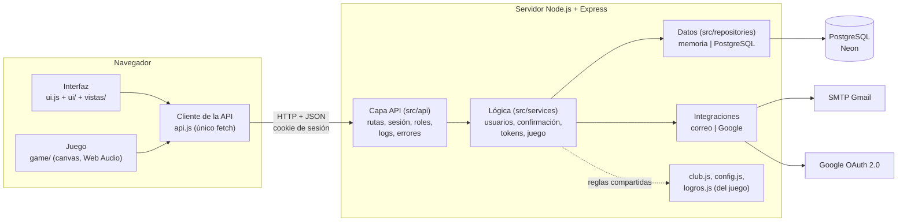

| Capa | Carpeta | Responsabilidad | No hace |
|---|---|---|---|
| Presentación | `public/` | Pintar vistas, validar formularios, mostrar avisos, jugar | No habla con la base de datos ni decide permisos |
| Cliente de la API | `public/js/api.js` | Peticiones HTTP, timeout de 15 s, traducir errores a `ApiError`, avisar si caduca la sesión | No pinta nada |
| API | `src/api/` | Rutas HTTP, sesión, autenticación y autorización, registro de peticiones, formato común de errores | No contiene reglas de negocio |
| Lógica | `src/services/` | Reglas de negocio | No conoce HTTP ni SQL |
| Datos | `src/repositories/` | Guardar y leer (memoria o PostgreSQL) con el mismo contrato | No valida reglas |
| Integraciones | `src/integrations/` | Correo y Google | No decide nada |
| Composición | `src/app.js`, `src/bootstrap.js` | Conectar las capas, elegir la base de datos, migrar, crear el primer administrador | — |

### 5.2 Decisiones de diseño

| Decisión | Alternativas | Por qué |
|---|---|---|
| **Express 5 sin framework de frontend** | React, Vue, Next.js | Proyecto individual y didáctico: las capas se ven como ficheros, no hay paso de compilación, el backend sirve el frontend (sin CORS) y la frontera interfaz/cliente que pide el Hito 2 queda en dos ficheros. Express 5 pasa los errores de las funciones `async` al manejador común |
| **Repositorio con dos implementaciones** (memoria y PostgreSQL) | Solo PostgreSQL; un ORM | Se puede arrancar y probar sin base de datos, y las **mismas pruebas** se pasan a las dos, lo que demuestra que la lógica no depende del almacenamiento (patrón Repository) |
| **Inyección de dependencias por parámetro** | Módulos globales, singletons | Cada servicio recibe sus dependencias (`userRepository`, `passwordHasher`, `mailer`, `tokenSigner`, reloj, azar), así que las pruebas usan versiones falsas sin trucos |
| **Sesiones en el servidor** (`express-session` + PostgreSQL) | JWT en el navegador | Cerrar sesión o eliminar una cuenta la invalida al momento; la cookie es `httpOnly` y no contiene datos; las sesiones sobreviven a los reinicios y despliegues |
| **Bajas lógicas** (`status = deleted`) con el email libre | Borrar la fila; bloquear el email para siempre | Se conserva el historial y la auditoría; la cuenta deja de poder entrar y su sesión deja de valer, pero su email y su mote quedan libres para que la persona pueda volver con una cuenta nueva (índice único parcial) |
| **Token de confirmación firmado (HMAC) sin guardar en la base de datos** | Token aleatorio en una tabla | No hace falta tabla ni limpieza; caduca solo; no se puede fabricar ni modificar sin el secreto |
| **OAuth 2.0 escrito con `fetch`** | Passport.js u otra librería | El flujo es corto y se entiende entero (`state`, intercambio del código, email verificado); menos dependencias y fácil de probar con un cliente falso |
| **Primer administrador por variables de entorno** | Script SQL, insertar a mano | No deja contraseñas en el código ni en scripts; es idempotente (si ya existe, no se toca) |
| **Migraciones SQL propias** | ORM con migraciones | Pocas tablas; SQL legible y versionado, con un registro de las aplicadas |
| **Cloud Run como principal y Render como alternativo** | Solo uno | Cloud Run aprovecha los créditos de educación, escala a cero y permite Secret Manager y acceso sin claves (WIF); Render fue el primer despliegue y queda de respaldo |
| **Reglas del juego compartidas cliente/servidor** | Reglas duplicadas | El servidor importa `club.js`, `config.js` y `logros.js`: una sola fuente de verdad para fichajes, entrenamiento y logros |
| **Concurrencia optimista** en el perfil del juego (`version`) | Bloqueos, transacciones largas | Dos peticiones simultáneas no pueden gastar dos veces la misma ficha; la segunda se reintenta con los datos nuevos |
| **Simulación del juego pura y determinista** | Lógica mezclada con el dibujo | Paso fijo de 1/60 s y azar con semilla: se prueba en Node sin navegador y el resultado no depende de los FPS |
| **Gráficos y sonido generados con código** | Imágenes y ficheros de audio | Sin problemas de derechos (nada oficial), carga instantánea y fácil de variar (equipaciones, selecciones, intensidad de la música) |

## 6. Diseño detallado

### 6.1 Backend: módulos

| Módulo | Qué hace |
|---|---|
| `server.js` | Punto de entrada: carga la configuración, llama a `bootstrap` y escucha en `PORT`; para con orden al recibir `SIGTERM` |
| `bootstrap.js` | Elige PostgreSQL (si hay `DATABASE_URL`) o memoria, aplica las migraciones, crea o promociona el primer administrador y crea el correo (SMTP o registro) |
| `app.js` | Construye la app Express: JSON, sesión, `/api` y los estáticos de `public/` |
| `config.js`, `loadConfig.js` | Leen y validan las variables de entorno; en producción exigen los secretos |
| `logger.js` | Logs JSON por línea, con niveles y ocultación de datos sensibles |
| `api/index.js` | Monta el router: `requestLogger`, `currentUser`, `/health`, `/auth`, `/prueba`, `/users` y `/juego` (con `requireAuth`), 404 y manejador de errores |
| `api/auth.js` | Registro, confirmación, reenvío, login, Google, logout y `me` |
| `api/users.js` | Administración de usuarios (`requireRole('admin')`, `requireSelfOrRole('admin')`) |
| `api/juego.js` | Perfil, partidas, contratos, entrenamiento, identidad, ranking y modo pruebas |
| `api/currentUser.js` | Middlewares de identidad, autenticación y autorización |
| `api/errorHandler.js` | Traduce los errores tipados a HTTP (`{ error: { code, message } }`) |
| `services/userService.js` | Reglas de usuarios: registro, autenticación, OAuth, roles, bajas, último administrador y primer administrador |
| `services/accountConfirmationService.js` | Crea y envía el enlace de confirmación, confirma y reenvía |
| `services/tokenSigner.js` | Tokens firmados con HMAC-SHA256 y caducidad |
| `services/passwordHasher.js` | bcrypt (coste 10; en las pruebas, 4) |
| `services/juegoService.js` | Reglas del servidor del juego: perfiles, partidas, validación anti-trampas, recompensas, logros, contratos, entrenamiento, identidad y ranking |
| `services/domainPolicy.js` | Prueba técnica: dominios permitidos |
| `services/errors.js` | Errores tipados: `ValidationError`, `UnauthorizedError`, `ForbiddenError`, `AccountPendingError`, `NotFoundError`, `ConflictError`, `ServiceUnavailableError` |
| `repositories/*` | `memoryUserRepository`, `postgresUserRepository`, `memoryJuegoRepository`, `postgresJuegoRepository` |
| `integrations/mailer.js` | Correo por SMTP (`nodemailer`) o, sin `SMTP_URL`, escrito en el registro |
| `integrations/googleOAuth.js` | URL de autorización de Google e intercambio del código por el perfil |
| `db/migrate.js`, `db/migrations/*.sql` | Migraciones versionadas (001 usuarios, 002 sesiones, 003 juego, 004 identidad, 005 email libre tras la baja) |

### 6.2 Modelo de datos

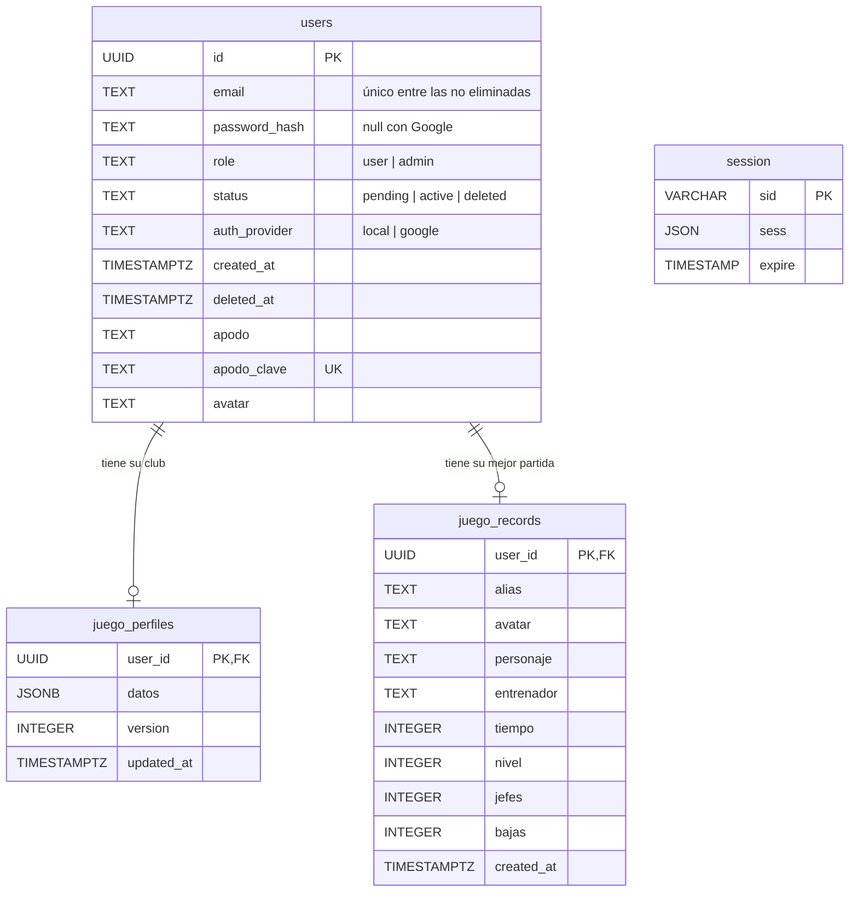

- **`users`**: una fila por cuenta. `email` normalizado (minúsculas, sin espacios) y único **entre las cuentas no eliminadas** (índice parcial de la migración 005), así que tras una baja se puede volver con el mismo email. `password_hash` es nulo en las cuentas de Google. `apodo_clave` es el mote normalizado (sin mayúsculas ni tildes) con índice único.
- **`session`**: la gestiona `connect-pg-simple`. Guarda el `userId` y, durante el acceso con Google, el `state`.
- **`juego_perfiles.datos`** (JSONB): plantilla (`jugadores` con jefes, bajas, partidas y estadísticas de entrenamiento), contadores (`jefesTotal`, `partidas`, `contratos`), logros con su fecha y la partida en curso (`partidaActual`). `version` sube en cada escritura (concurrencia optimista).
- **`juego_records`**: la mejor partida de cada usuario (más tiempo; en empate, más nivel), con el mote y el avatar para el ranking.

**Estados de una cuenta**

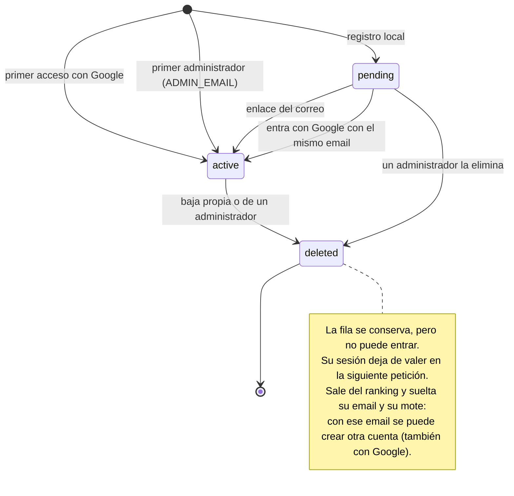

### 6.3 Frontend

- **SPA con rutas por hash** (`public/js/ui.js`): `#/` inicio, `#/entrar`, `#/registro`, `#/perfil`, `#/jugar` y `#/admin`, y una vista 404 («Fuera de juego»). Cada ruta declara si es protegida, solo para invitados o solo para administradores; la interfaz redirige, pero **la protección real está en el servidor**.
- **Vistas** (`ui/vistas/*.js`): cada una exporta `montar(raiz, contexto)` y devuelve una función de limpieza. Se cargan bajo demanda con `import()`.
- **Estado** (`ui/estado.js`): el usuario actual; la cabecera (`ui/cabecera.js`) se repinta al cambiar (mote, avatar, enlaces según el rol).
- **Formularios** (`ui/formulario.js`): validación al escribir (una vez tocado el campo) y al enviar, errores enlazados con `aria-describedby`, botón «Mostrar contraseña», envío doble bloqueado con una rueda de carga.
- **Avisos** (`ui/avisos.js`): mensajes temporales en una zona `aria-live`; los errores usan `role="alert"`. Los que vienen del servidor por redirección (`?aviso=cuenta-confirmada`, `google-cuenta-creada`…) se leen al cargar y se quitan de la barra de direcciones.
- **Componentes** (`ui/componentes.js`): rueda de carga, estado vacío, estado de error con **Reintentar** y `mensajeDeError`, que traduce cualquier error a un texto legible y lo registra en la consola.
- **Diálogos** (`ui/modal.js`): confirmación accesible con el elemento nativo `<dialog>` (sustituye a `window.confirm`): el foco va al botón seguro, `Esc` cierra y el foco vuelve a donde estaba. Se usa antes de cualquier acción destructiva.
- **Cliente** (`api.js`): único sitio con `fetch`; timeout de 15 s con `AbortController`; convierte las respuestas de error en `ApiError` (estado, código y mensaje); si una petición devuelve `401` con sesión, avisa a la interfaz de que la sesión ha caducado.
- **Sistema de diseño** (`public/css/`): tokens (colores, espacios, radios), base, componentes y vistas; tipografía Plus Jakarta Sans autoalojada; modo oscuro rojiblanco; diseño responsive (la tabla de administración se convierte en tarjetas en el móvil).

### 6.4 API

La lista completa de rutas, con su acceso y su contrato, está en el [README](../README.md#api). Resumen:

| Grupo | Rutas | Acceso |
|---|---|---|
| Salud | `GET /api/health` | Público |
| Autenticación | `POST register`, `POST login`, `POST logout`, `GET me`, `GET confirm`, `POST resend-confirmation`, `GET providers`, `GET google`, `GET google/callback` | Público (salvo `me`) |
| Usuarios | `GET /users`, `GET /users/:id/active`, `PATCH /users/:id/role`, `DELETE /users/:id` | Admin (la baja, propio o admin) |
| Juego | `GET perfil`, `POST partidas`, `POST partidas/:id/fin`, `POST contratar`, `POST entrenar`, `PUT identidad`, `GET ranking`, `POST desbloquear` | Sesión (`desbloquear`, admin) |
| Prueba técnica | `POST /api/prueba/dominio` | Público |

## 7. Flujos con diagramas de secuencia

### 7.1 Registro con email y contraseña

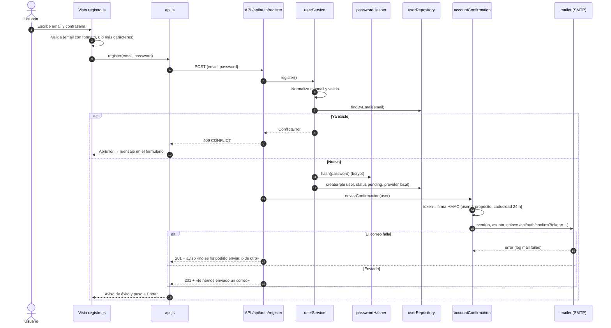

### 7.2 Confirmación con el enlace del correo

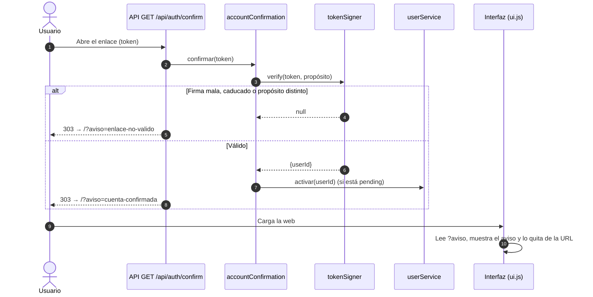

### 7.3 Inicio de sesión local (incluye cuenta pendiente y reenvío)

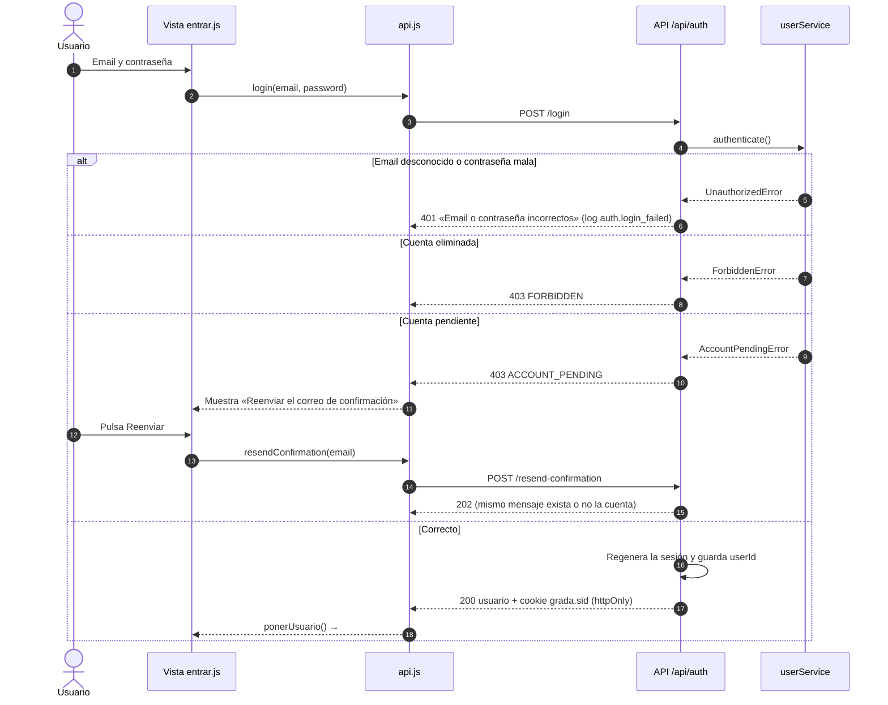

### 7.4 Inicio de sesión con Google (OAuth 2.0, código de autorización)

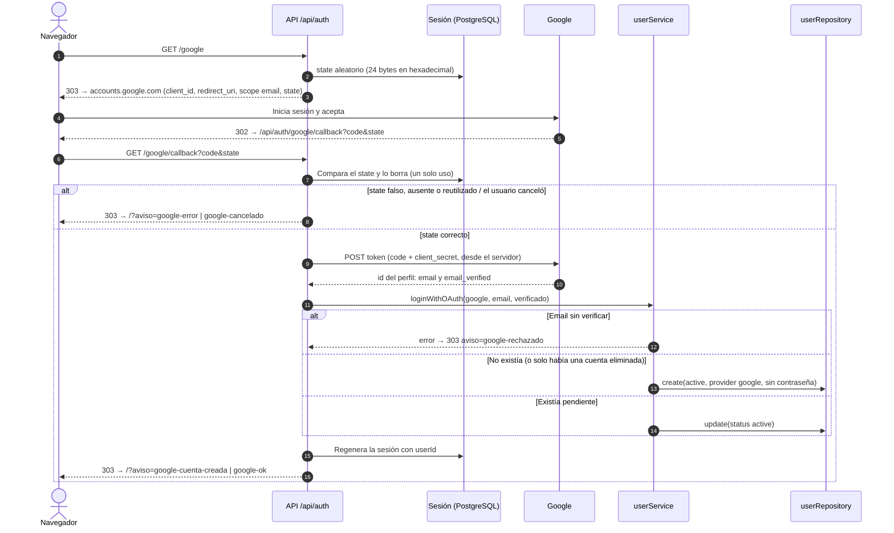

### 7.5 Recuperar la sesión al recargar y cerrar sesión

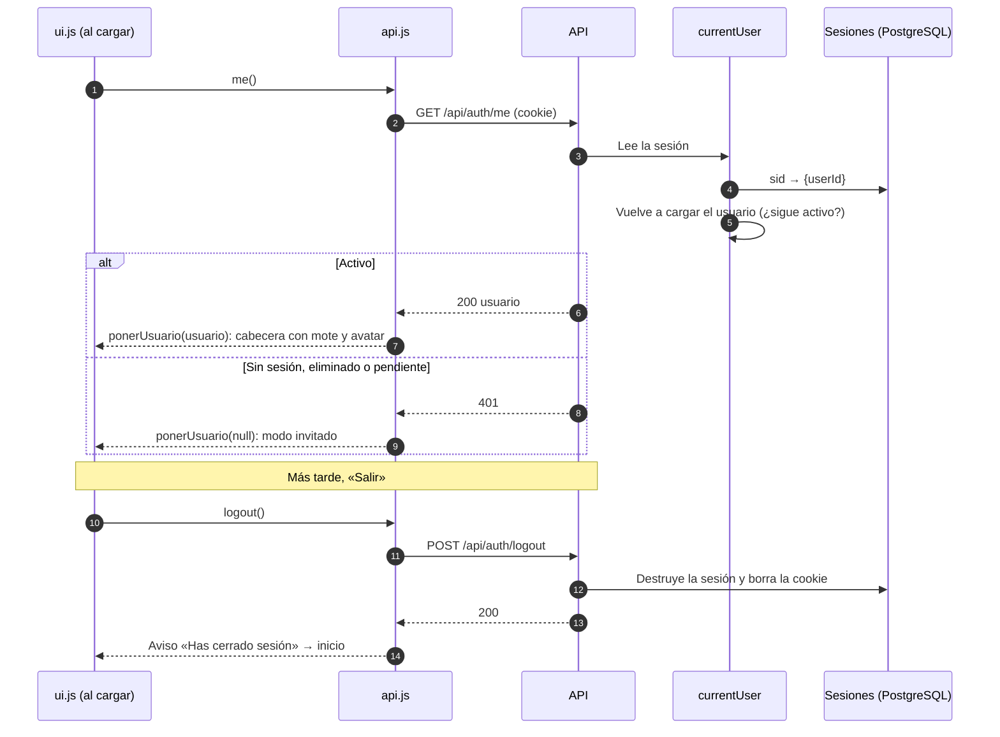

### 7.6 Petición protegida y autorización por roles

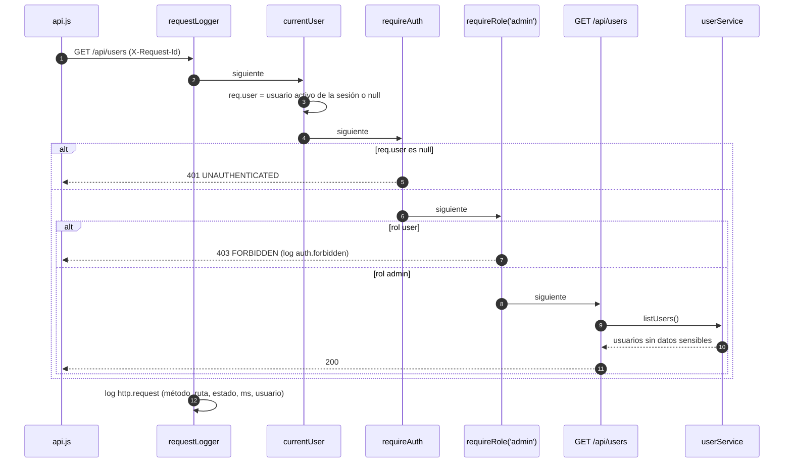

### 7.7 Cambiar el rol y proteger al último administrador

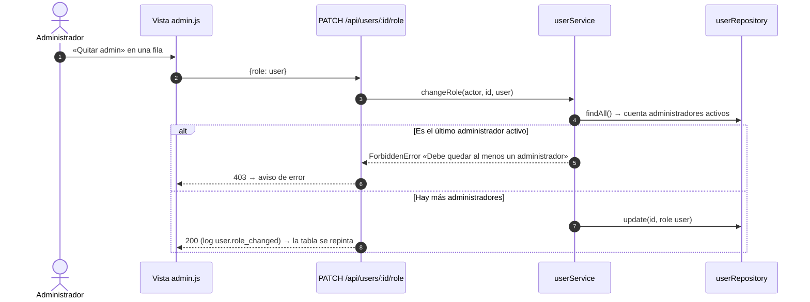

### 7.8 Darse de baja

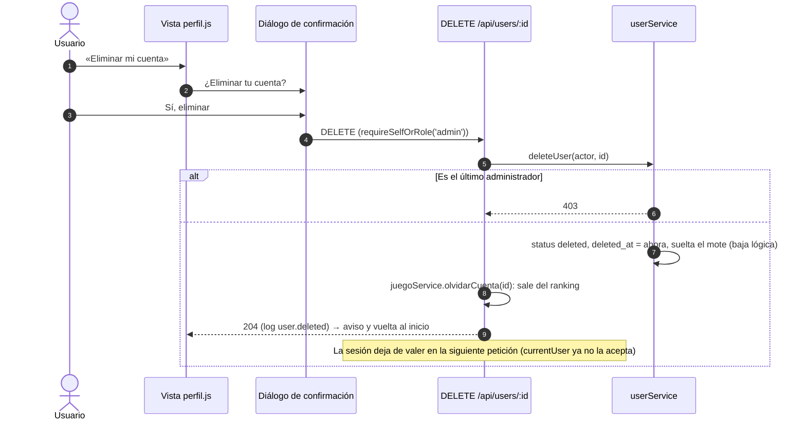

### 7.9 Arranque: base de datos, migraciones y primer administrador

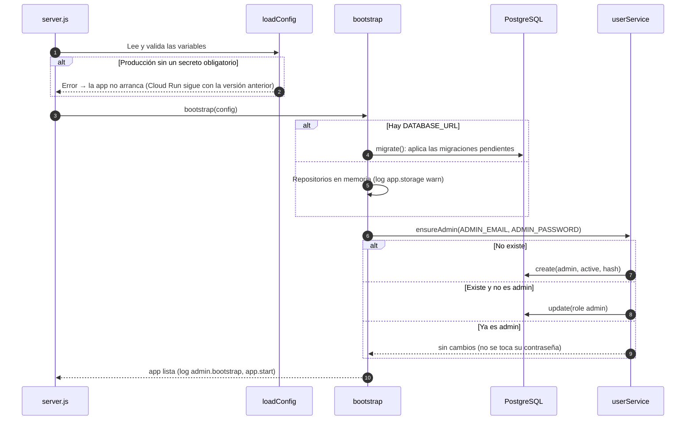

### 7.10 Una partida del juego (inicio, juego y fin con validación)

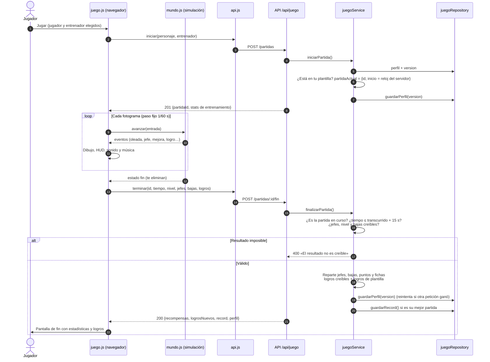

### 7.11 Contratar con una ficha (concurrencia optimista)

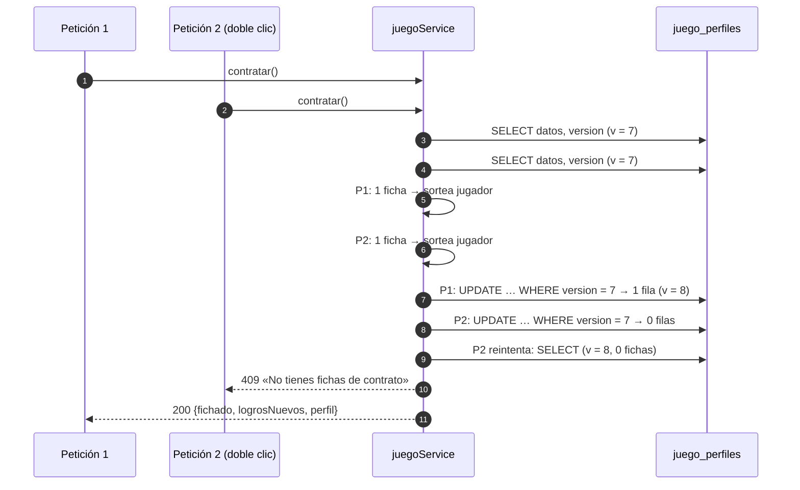

### 7.12 Integración y despliegue continuos

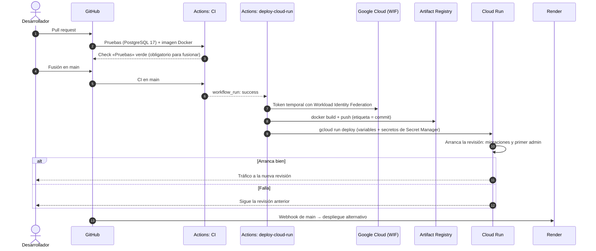

### 7.13 Prueba técnica: dominio permitido

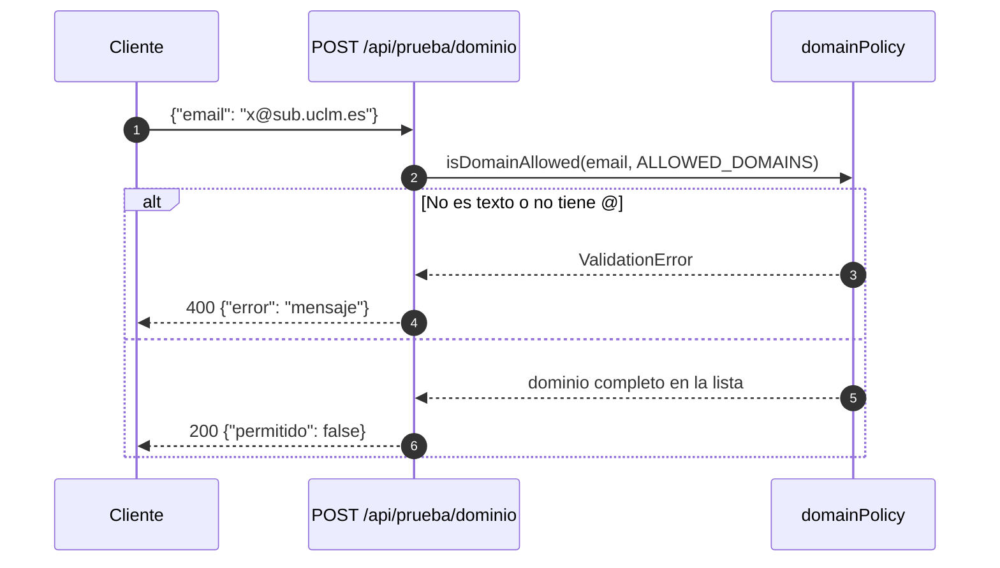

## 8. Seguridad

| Amenaza | Medida | Dónde |
|---|---|---|
| Robo de contraseñas | Solo se guarda el hash **bcrypt** (sal, coste 10). Nunca la contraseña ni un cifrado reversible | `passwordHasher.js` |
| Fuerza bruta / enumeración | El mismo mensaje si el email no existe o la contraseña es incorrecta; el reenvío responde igual exista o no la cuenta; los intentos fallidos se registran con IP | `userService.js`, `auth.js` |
| Robo o fijación de sesión | Cookie `httpOnly`, `sameSite=lax`, `secure` en producción; la sesión se **regenera** al entrar y se destruye al salir; las sesiones se guardan en el servidor | `app.js`, `auth.js` |
| Sesión de una cuenta eliminada | En cada petición se vuelve a cargar el usuario; si ya no está activo, la sesión deja de valer | `currentUser.js` |
| Escalada de privilegios | Roles comprobados en el servidor (`401`/`403`); la interfaz solo oculta; siempre queda un administrador | `currentUser.js`, `userService.js` |
| Enlaces falsificados | Token HMAC-SHA256 con clave derivada, comparación en tiempo constante, propósito y caducidad (24 h) | `tokenSigner.js` |
| CSRF en OAuth | `state` aleatorio, guardado en la sesión, de un solo uso | `auth.js` |
| Robo del secreto de Google | El código se cambia por el perfil en el servidor; el `client_secret` nunca llega al navegador; solo se acepta un email verificado | `googleOAuth.js` |
| Inyección SQL | Consultas parametrizadas | `postgres*Repository.js` |
| XSS | El DOM se crea con `textContent` (helper `h()`); una prueba lo comprueba; los correos escapan el HTML | `dom.js`, `frontend.test.js`, `accountConfirmationService.js` |
| Secretos expuestos | Solo variables de entorno; Secret Manager con una cuenta de servicio de mínimo privilegio; `.env` ignorado; GitHub accede a Google Cloud sin claves (WIF) | `loadConfig.js`, workflows |
| Datos sensibles en logs | Contraseñas, hashes, cookies, tokens y secretos se sustituyen por `[oculto]` | `logger.js` |
| Trampas en el juego | Reloj del servidor, límites creíbles, logros verificables, concurrencia optimista | `juegoService.js` |
| Privacidad | Política de privacidad pública; el ranking no muestra correos | `privacidad.html`, `juegoService.ranking` |

## 9. El juego

### 9.1 Concepto

Un *survivor* (género popularizado por *Vampire Survivors*) con estética de píxeles «chibi»: controlas a un jugador de la historia del Atlético de Madrid, las armas atacan solas y tu trabajo es moverte, esquivar y elegir mejoras para aguantar cada vez más contra oleadas infinitas de rivales y jefes. La progresión entre partidas (club, fichajes, entrenamiento, logros) se guarda en el servidor.

### 9.2 Cómo se juega (manual de usuario)

1. **Entrar:** con sesión iniciada, `#/jugar` abre el menú del juego. La primera vez pide un **mote** (3 a 16 caracteres, único) y una **cara** para el avatar.
2. **Menú:** Jugar, Vestuario (elegir jugador y equipación), Entrenamiento, Contratar, Logros, Combinaciones, Dirección (entrenador), Ranking y Ajustes; a la izquierda, tu ficha y tus tiempos.
3. **Controles:** WASD o flechas (en el móvil, joystick al arrastrar); `Espacio`/`E` ulti; `Esc`/`P` pausa; `F` pantalla completa; `1`–`3` para elegir mejora.
4. **Partida:** oleada nueva cada 30 s y un jefe cada cuatro oleadas (cada 2 minutos, el primero a los 1:30). Los rivales sueltan experiencia; al subir de nivel eliges una de tres mejoras (las que completan una combinación salen marcadas con ★).
5. **Ambientes:** cada 5 minutos cambia la pantalla: pretemporada → Final de la Copa del Rey → Final de Liga → Final de la Champions → Final del Mundial (todos con la camiseta de su selección). Los rivales salen más fuertes y suena la fanfarria de la competición.
6. **Fin:** al caer, pantalla de estadísticas (tiempo, ambiente, bajas, jefes, daño por habilidad, golpe más fuerte, daño recibido, logros nuevos) y recompensas del club.

### 9.3 Sistemas

| Sistema | Descripción | Configuración |
|---|---|---|
| **Jugadores** | 36 (4 porteros, 9 defensas, 13 medios, 10 delanteros). La posición fija las estadísticas base; cada jugador tiene rasgos propios y una lista de habilidades que puede aprender | `PERSONAJES`, `POSICIONES` |
| **Rarezas** | Según lo que fue cada uno **en el Atleti** (años, títulos, peso en la historia): Leyenda (8), Épico (8), Raro (8) y Común (12). Más rareza = más habilidades (de 8 a 16) y menos probabilidad en un contrato | `RAREZAS` |
| **Entrenadores** | Cholo Simeone (+daño, +vida; ulti «¡Partido a partido!») y Luis Aragonés (+velocidad, +experiencia; ulti «Furia Roja») | `ENTRENADORES` |
| **Armas y habilidades** | 24, con 5 niveles: de disparo (balón, cañonazo de falta, córner, efecto, vaselina, chilena, volea, penalti), cuerpo a cuerpo (bufanda, banderines, cántico, silbato, tarjeta roja, VAR, cabezazo, entrada rasante, barrera, despeje), movilidad (regate, caño, pared, contragolpe) y especiales (himno de la Champions, bengala). Las más fuertes no suben hasta cierto minuto (`desdeMinuto`) y tienen recarga mínima (`cdMin`) | `ARMAS` |
| **Pasivas** | 14 (botas, imán, pasión, pizarra, cantera, masajista, espinilleras, pulmones, toque dorado, botas en llamas, paradón, brazalete, trébol, prórroga) | `PASIVAS` |
| **Combinaciones** | 24 «metas» que se activan al juntar ciertas habilidades a cierto nivel y dan bonus (Muro rojiblanco, Tiki-taka, Pichichi, Catenaccio, Leyenda rojiblanca, Golazo de otro planeta, Remontada épica, Triple Corona, Infierno del Metropolitano, Capitán eterno…) | `SINERGIAS` |
| **Ultras** | 6 que se consiguen solas al completar varias combinaciones: Premio Puskás, Ganador del Balón de Oro, MVP de la Champions, Trofeo Zamora, Bota de Oro histórica y Mejor jugador del Mundial. Efecto visual propio y daño en parte porcentual (menor contra jefes) | `ULTRAS`, `ultras.js` |
| **Rivales** | 16 equipos con jugadores genéricos; unos embisten (Liverpool, Arsenal, PSG, Dortmund) y otros disparan (Bayern, City, Chelsea, Juventus, Milan, Inter, Nápoles); élites blindado, veloz y furioso | `EQUIPOS`, `ELITES` |
| **Jefes** | 10: Guardiola (rondo, tiki-taka), Mourinho (autobús), Cristiano («Siuuu»), Messi (eslalon), Vinicius (zigzag), Yamal (rosca), Neymar (lluvia de bicicletas), Bale (cañonazos), Benzema (precisión) y Suárez (mordiscos). Tres fases por vida (66 % y 33 %), escolta de élites desde el segundo jefe, furia si tardas en ganarles y una jugada estrella en la fase 3. Desde la oleada 24 pueden salir dos a la vez y cada vuelta completa los hace un 25 % más duros | `JEFES`, `jefes.js` |
| **Dificultad** | Crecimiento continuo de vida, daño y velocidad; tramo final más duro desde el minuto 9 y rivales «curtidos» desde el 12; multiplicador por ambiente; ayuda inicial que se apaga en ocho minutos | `ESCALADO`, `TRAMO_FINAL`, `CURTIDOS`, `AMBIENTES` |
| **Movimiento** | Inercia, *ritmo* al correr (más daño y experiencia), castigo por quedarse quieto, premios por el campo | `FISICA`, `JUGADOR` |
| **Mundo** | Procedural e infinito por semilla, con ruidos suaves: distritos (ciudad, entrenamiento, parque, prado), estadios con gradas, plazas y tiendas, mesetas con escaleras, barro, lluvia y caminos. Colisión por los pies (vista 3/4) | `TERRENO`, `terreno.js` |
| **Club** | Plantilla inicial de 4 comunes (un jugador por posición); una ficha de contrato por cada 3 jefes de la cuenta; puntos de entrenamiento por jefes (1 cada 3) y por bajas; estadísticas Vida, Defensa, Disparo y Suerte (máx. 20) | `club.js` |
| **Logros** | 29 con un dato curioso de la historia del Atleti (tabla 9.6); 10 equipaciones desbloqueables | `logros.js` |
| **Sonido** | Efectos, música chiptune original (canción por ambiente que se anima con el tiempo y con los jefes, fanfarria por competición) y la grada (murmullo y cánticos según la distancia a las gradas) | `audio.js`, `musica.js` |

### 9.4 Arquitectura del juego

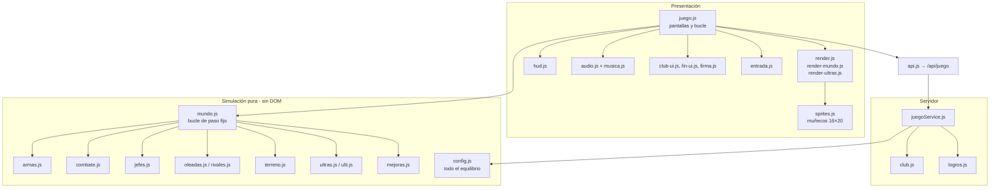

- **Determinismo.** `mundo.js` avanza con un paso fijo de 1/60 s y un generador aleatorio con semilla. Si el navegador va lento, se hacen varios pasos por fotograma (con un tope); el resultado no depende de los FPS y las pruebas son reproducibles.
- **Eventos.** La simulación no toca el DOM ni el audio: deja eventos (`oleada`, `aviso`, `jefe-derrotado`, `ambiente`, `ultra`…) que `juego.js` traduce a sonido, avisos y anuncios para lectores de pantalla.
- **Estadísticas.** Cada fuente de daño (arma, ultra, ulti, quemaduras) se apunta en `mundo.stats` para la pantalla de fin.
- **Rendimiento.** Búsqueda de obstáculos por celdas con claves numéricas (unas 4,5 veces más rápida que la primera versión), una textura de suelo por celda y ambiente, pintada como mucho una por fotograma y por adelantado, y muñecos cacheados.
- **Dibujo.** Canvas 2D con cámara 3/4 (el suelo se aplasta en vertical y los muñecos están de pie). Los muñecos se pintan con código en una cuadrícula de 16×20 (pelo, piel, camiseta, botas y rasgos como brazalete, cinta, pecas, barba o pendientes), así que se generan las equipaciones y las camisetas de 26 selecciones sin imágenes.
- **Audio.** Todo sintetizado con Web Audio: ondas de pulso (12,5 %, 25 % y 50 %), triángulo y ruido. La música es un secuenciador propio que programa las notas por adelantado; la grada usa voces con formantes de vocales y palmas.

### 9.5 Servidor del juego y anti-trampas

- Al **empezar**, el servidor guarda la partida en curso con su propio reloj.
- Al **terminar**, rechaza el resultado si la partida no es la que está en curso, si el tiempo supera lo transcurrido (con 15 s de margen) o 4 horas, o si los jefes, el nivel o las bajas no son creíbles para ese tiempo (`jefes ≤ 3 + t/50`, `nivel ≤ 8 + t/3`, `bajas ≤ 20·t + 50`).
- De los **logros** que manda el cliente, solo apunta los que puede comprobar con lo que sabe (tiempo, jefes, bajas, jugador y entrenador); los de plantilla los calcula él.
- Cada cambio del perfil usa **concurrencia optimista** (`UPDATE … WHERE version = $n`) con reintentos.
- El **ranking** guarda la mejor partida de cada usuario con su mote y avatar, nunca el correo.

### 9.6 Logros

| Logro | Cómo se consigue | Equipación |
|---|---|---|
| Primera muesca | Vence a tu primer jefe | Segunda |
| Camino de la final | Llega a la Final de la Copa del Rey (minuto 5) | |
| Campeones de Liga | Llega a la Final de Liga (minuto 10) | Tercera eléctrica |
| Noche europea | Llega a la Final de la Champions (minuto 15) | Noche europea |
| Final del Mundial | Llega a la Final del Mundial (minuto 20) | Final del Mundial |
| Tercero en París | Consigue la ultra «Ganador del Balón de Oro» con Griezmann | |
| Bota de Oro charrúa | Consigue la ultra «Bota de Oro histórica» con Forlán | |
| Hamburgo, 2010 | Llega a la Final de la Champions con Forlán o con el Kun | |
| Noche de Mónaco | Vence a 3 jefes en una partida con Falcao | |
| El cabezazo del Camp Nou | Consigue la combinación «Dominio aéreo» con Godín | |
| Brazalete eterno | Consigue la combinación «Capitán eterno» con Gabi | |
| El Niño | Llega a la Final de la Copa del Rey con Fernando Torres | |
| Del Oporto al Calderón | Consigue la combinación «Jugón» con Futre | |
| Doblete del 96 | Llega a la Final de Liga con Simeone o con Pantić | Doblete del 96 |
| Bernabéu, 2013 | Llega a la Final de la Copa del Rey con Miranda o con Courtois | |
| Cinco Zamoras | Consigue la ultra «Trofeo Zamora» con Oblak | Leyenda bajo palos |
| Los 27 de Costa | Elimina a 270 rivales en una partida con Diego Costa | |
| La Araña campeona | Llega a la Final del Mundial con Julián Álvarez | |
| El récord de Adelardo | Elimina a 553 rivales en una sola partida | |
| El Sabio de Hortaleza | Aguanta 10 minutos con Luis Aragonés en el banquillo | |
| Partido a partido | Aguanta 15 minutos con el Cholo en el banquillo | |
| El muro | Aguanta los 5 primeros minutos sin que te toquen | |
| Poder de leyenda | Consigue tu primera ULTRA | |
| Leyenda total | Consigue tres ULTRAS en una partida | |
| Mil en el Metropolitano | Elimina a 1000 rivales en una partida | |
| El Pupas | Que te eliminen antes del minuto 2 | El Pupas |
| Toda una vida | Juega 20 partidas con Koke | Adiós al Calderón |
| Azul y blanco | Ten 20 jugadores en tu plantilla | Centenario 1903 |
| Paseo de Leyendas | Ficha a las 8 leyendas | |

Cada logro esconde un dato real del club (por ejemplo, que Griezmann fue tercero en el Balón de Oro de 2018, que Oblak ganó cinco Zamoras seguidos o que el Atleti nació en 1903 vestido de azul y blanco). Los datos están en `logros.js` y se han comprobado uno a uno.

### 9.7 Evolución por fases

| Fase | Qué se añadió | Problemas que resolvió |
|---|---|---|
| Rediseño | Nueva interfaz (tokens, tipografía, modo oscuro rojiblanco), menú del juego como inicio con sesión | La interfaz del sprint era funcional pero sobria |
| 1 | Survivor base: simulación, oleadas, armas, mejoras, jefes y menú con el muñeco paseando | — |
| 2 | Club en el servidor (plantilla, contratos, entrenamiento), ranking de la grada, élites y poderes nuevos | Progreso ligado a la cuenta y validado |
| 3 | 6 ultras, 24 combinaciones, dificultad con castigo, entrenamiento por bajas y modo pruebas | Maxear una sola cosa ya no basta |
| 4 | Mundo procedural natural, 5 ambientes por finales, mote y avatar | Mapa repetitivo; correo visible en el ranking |
| 5 | Rarezas por historia rojiblanca, habilidades niveladas, combinaciones a la vista, animación de la firma, colisiones exactas | Regate demasiado fuerte; esconderse detrás de los tejados |
| 6 | 29 logros con historia y 10 equipaciones, estadísticas de fin, música chiptune y grada, muñecos con más detalle, jefes con escolta, furia y jugada estrella | Falta de objetivos a largo plazo; sonido pobre; jefes fáciles |

## 10. Pruebas

### 10.1 Estrategia

- **Framework:** `node:test` (incluido en Node, sin dependencias) y `node:assert/strict`.
- **Un único comando:** `npm test`. En local no hace falta base de datos (`pg-mem`); en el CI se ejecutan contra un PostgreSQL 17 real.
- **Niveles:**
  - **Unitarias** de la lógica (`userService`, `tokenSigner`, `domainPolicy`, `logger`, `mailer`) con dependencias falsas inyectadas.
  - **Contrato del repositorio:** la misma batería contra la implementación en memoria y la de PostgreSQL.
  - **Integración de la API:** peticiones HTTP reales a la app montada en un puerto aleatorio (`tests/helpers.js`), con cookies, cubriendo `401`, `403`, `409`…
  - **Integración con OAuth y correo:** Google y SMTP sustituidos por versiones falsas (no se llama a nadie).
  - **Base de datos real** (`api.database.test.js`, solo en el CI): registro, inicio de sesión y sesión guardada en PostgreSQL.
  - **Frontend estático:** que solo `api.js` use `fetch`, que no se meta texto de usuario como HTML y que todos los módulos se importen.
  - **Simulación del juego:** mundos con semilla avanzados paso a paso (jefes, ultras, colisiones, alcance del mapa, equilibrio, logros).
- **Casos de error primero:** muchas pruebas comprueban rechazos (email repetido, cuenta pendiente, usuario normal que intenta eliminar a otro, último administrador, enlace manipulado o caducado, `state` reutilizado, resultado de partida imposible, dos contratos a la vez).
- **Reloj y azar inyectables** para probar la caducidad de los enlaces y la validación de las partidas sin esperar.

### 10.2 Pruebas por fichero

| Fichero | Pruebas | Qué comprueba |
|---|---:|---|
| `userService.test.js` | 27 | Registro, email repetido o inválido, contraseña corta, autenticación, pendiente, eliminada, volver con el mismo email tras la baja, OAuth, roles, bajas, último administrador, primer administrador |
| `api.auth.test.js` | 16 | Registro (201 sin hash), 409/400, login, mismo mensaje en 401, cookie `HttpOnly`, `me`, logout, sesión de una cuenta eliminada, confirmación, enlace no válido, URL pública, reenvío 202, correo caído (503) |
| `userRepository.test.js` | 16 | Contrato del repositorio en memoria y en PostgreSQL, incluida la cuenta eliminada que no ocupa su email |
| `frontend.test.js` | 14 | Separación interfaz/cliente, sin HTML de usuario, módulos importables |
| `domainPolicy.test.js` | 13 | Prueba técnica (8 de rechazo o error) |
| `api.users.test.js` | 11 | 401, 403, listado, activo, cambio de rol, bajas propias y ajenas, último administrador |
| `googleOAuth.test.js` | 11 | Proveedores disponibles, redirección con `state`, cuenta nueva, existente y pendiente que se confirma, `state` incorrecto, ausente y reutilizado, cancelación, email sin verificar, volver a entrar con Google tras darse de baja (cuenta nueva), cliente real con `fetch` falso y configuración |
| `config.test.js` | 8 | Secretos obligatorios en producción, valores por defecto, `.env` fuera del repositorio |
| `accountConfirmation.test.js` | 6 | Correo con enlace, confirmación, enlace manipulado/caducado, eliminada, doble confirmación, reenvío |
| `logger.test.js` | 6 | JSON, niveles, ocultación de datos sensibles |
| `tokenSigner.test.js` | 3 | Firma, manipulación y caducidad |
| `mailer.test.js` | 3 | SMTP o registro |
| `migrate.test.js` | 3 | Crea las tablas, es idempotente y aplica las restricciones (email único, roles válidos) |
| `bootstrap.test.js` | 2 | Arranque con memoria y con PostgreSQL |
| `health.test.js` | 1 | `/api/health` |
| `api.database.test.js` | CI | Recorrido completo con PostgreSQL real |
| `juego-club.test.js` | 27 | Club, contratos, entrenamiento, rarezas, ranking |
| `juego-movilidad.test.js` | 22 | Mundo, colisiones, mesetas, alcance del mapa, ambientes |
| `api.juego.test.js` | 15 | API del juego, anti-trampas, logros en el servidor, concurrencia, cuenta eliminada que sale del ranking |
| `juego-personajes.test.js` | 14 | Personajes, entrenadores, habilidades por jugador |
| `juego-habilidades.test.js` | 14 | Habilidades nuevas y niveles por minuto |
| `juego-ultras.test.js` | 13 | Ultras: cómo se consiguen y qué hacen |
| `juego-logros.test.js` | 13 | Logros, equipaciones, estadísticas, pantalla de fin, música y jefes más duros |
| `game.test.js` | 10 | Simulación base (paso fijo, semilla, armas, jefes, ulti, dificultad) |
| `juegoRepository.test.js` | 8 | Repositorio del juego en memoria y PostgreSQL |
| **Total** | **276** | 140 del Sprint 1 (cuentas, API, datos, seguridad, prueba técnica) y 136 del juego |

### 10.3 Comprobaciones manuales y visuales

Además de las pruebas automáticas, cada cambio visible se ha comprobado en el navegador con Playwright (capturas de pantalla automatizadas de cada pantalla y estado), y el Hito 4 se probó a mano en producción (correo real recibido en Gmail, enlace manipulado, acceso con dos cuentas de Google distintas). Las capturas de la [sección 16](#16-índice-de-capturas) se generan con la aplicación real y datos de ejemplo.

## 11. Integración y despliegue continuos

| Workflow | Cuándo | Qué hace |
|---|---|---|
| `ci.yml` (*CI*) | Cada PR y cada push a `main` y a `hito-*/integracion` | Trabajo **Pruebas**: `npm ci` + `npm test` con un servicio PostgreSQL 17. Trabajo **Imagen Docker**: construye la imagen, la arranca y comprueba `/api/health` |
| `deploy-cloud-run.yml` | Cuando el CI termina bien en `main` (`workflow_run`) | Autentica en Google Cloud con Workload Identity Federation, construye y sube la imagen a Artifact Registry y despliega en Cloud Run con las variables (`NODE_ENV`, `ALLOWED_DOMAINS`) y los 8 secretos de Secret Manager |
| `memoria.yml` | Cambios en `memoria/` | Compila la memoria con LuaLaTeX (latexmk + biber) y publica el PDF como artefacto |
| Render | Cada cambio en `main` | Despliegue alternativo según `render.yaml` |

- **Imagen Docker:** Node 22 (Alpine), solo dependencias de producción, usuario sin privilegios, escucha en el 8080.
- **Cloud Run:** región `europe-southwest1` (Madrid), escala a cero, secretos montados como variables de entorno, cuenta de servicio de ejecución con acceso solo a sus secretos.
- **Base de datos:** Neon (PostgreSQL gestionado, región Frankfurt), compartida por Cloud Run y Render.
- **Seguridad del despliegue:** GitHub no guarda ninguna clave de Google Cloud; obtiene un token temporal por federación de identidad.
- **Resiliencia:** si una revisión no arranca (por ejemplo, falta un secreto), Cloud Run y Render siguen sirviendo la anterior.
- **Preparación única:** `scripts/gcp/preparar-cloud-run.sh` (proyecto, APIs, Artifact Registry, secretos, cuentas de servicio, WIF) y `scripts/gcp/configurar-hito4.sh` (secretos de correo y Google). Pasos en [`docs/hito4-configuracion.md`](hito4-configuracion.md).

## 12. Registro de actividad y manejo de errores

### 12.1 Logs

Una línea JSON por evento en la salida estándar (Cloud Logging en producción), con `time`, `level`, `event`, `msg` y datos, por ejemplo `{"time":"2026-10-12T10:00:00.000Z","level":"info","event":"auth.login","msg":"Inicio de sesión","userId":"..."}`. Cada petición lleva un identificador (`X-Request-Id`) que aparece en todas sus líneas. Eventos: `app.start`, `app.stop`, `app.storage`, `app.mail`, `admin.bootstrap`, `http.request`, `http.error`, `user.registered`, `auth.login`, `auth.logout`, `auth.login_failed`, `auth.forbidden`, `mail.confirmation_sent`, `mail.failed`, `mail.not_sent`, `user.confirmed`, `user.confirm_failed`, `auth.oauth_denied`, `auth.oauth_failed`, `user.role_changed`, `user.deleted` y `juego.identidad`. Los datos sensibles se sustituyen por `[oculto]`.

### 12.2 Errores de principio a fin

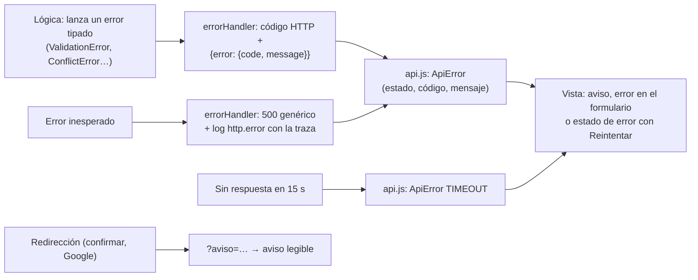

- El usuario nunca ve JSON ni trazas: cada error se traduce a un mensaje en español.
- La interfaz tiene estados de **carga**, **vacío** y **error con reintento**, y una captura global de promesas rechazadas.
- Los formularios marcan el campo con el error y lo explican debajo; al fallar el servidor, el formulario muestra el error arriba sin perder lo escrito (salvo la contraseña).

## 13. Problemas encontrados y cómo se resolvieron

| Problema | Causa | Solución |
|---|---|---|
| Un JSON mal formado devolvía la página de error HTML de Express | El error ocurría en `express.json()`, antes de la capa API | Manejador propio justo después del parser: `400` en JSON en toda la API (prueba técnica) |
| El correo no salía desde Cloud Run | El SMTP sin cifrar (puerto 25/587) suele estar bloqueado | SMTP de Gmail por el puerto 465 con contraseña de aplicación, guardada en Secret Manager |
| `redirect_uri_mismatch` al entrar con Google | Cloud Run tiene dos formas de URL y cada una necesita su URI de redirección | Registrar las dos en el cliente de Google y usar `PUBLIC_URL` |
| Las ramas del Hito 4 dependían unas de otras | Se desarrollaron en cadena | Reubicarlas (rebase) sobre el `main` real antes de abrir los PRs, cada una con el CI en verde |
| Cambiar de proveedor de despliegue a mitad del sprint | Llegaron créditos de Google Cloud | Nuevo PBI P19 (cambio de alcance documentado), Docker y Cloud Run como principal, Render como alternativo |
| El juego dejó de cargar tras un cambio | Una variable del módulo usada en la plantilla HTML antes de existir | Arreglo inmediato y una prueba que importa todos los módulos del juego |
| Los jugadores podían esconderse detrás de los tejados | La colisión no coincidía con el dibujo en la vista 3/4 | Colisión por los pies y obstáculos que chocan en todo su dibujo |
| Tirones al pintar el suelo | Se pintaban muchas texturas por píxel en el mismo fotograma | Una textura por celda y ambiente, como mucho una por fotograma y por adelantado |
| Simulación lenta con muchos rivales | Búsqueda de obstáculos con claves de texto y demasiadas celdas | Búsqueda por radio con claves numéricas: unas 4,5 veces más rápida |
| El regate hacía al jugador intocable demasiado pronto | Subía de nivel sin límite | Niveles que no salen hasta cierto minuto y recarga mínima |
| Equilibrio difícil de ajustar a mano | Muchas variables | Todo el equilibrio en `config.js` y calibración con un bot que juega partidas simuladas |
| Quien eliminaba su cuenta (sobre todo de Google) no podía volver a entrar nunca con ese email (lo encontró un amigo probando la app, 29/10/2026) | Por la baja lógica la fila seguía en `users` con su email, que era `UNIQUE`; además, por diseño, una cuenta eliminada no podía entrar «ni con Google» | Migración 005: el email solo es único entre las cuentas no eliminadas (índice parcial); `findByEmail` ignora las eliminadas, así que registrarse o entrar con Google crea una cuenta nueva; al eliminar se suelta el mote y la cuenta sale del ranking. Pruebas nuevas del caso completo |
| Al pulsar «Reenviar el correo» después de un error de inicio de sesión, el primer clic se perdía | Al salir del campo de contraseña vacío aparecía su error, la página se movía y el clic caía fuera del botón | Un campo vacío que no se ha tocado ya no da error al salir de él; tras un fallo del servidor la contraseña se vacía sin marcar error (encontrado al hacer las capturas, 27/10/2026) |

## 14. Métricas del proyecto

| Métrica | Valor |
|---|---|
| PBIs / tareas del Sprint 1 | 19 / 32 |
| Pull requests | Más de 50 (uno por tarea, uno por cierre de hito y uno por fase del juego) |
| Releases | `hito-1`, `hito-2`, `hito-3`, `hito-4`, `sprint-1` |
| Pruebas automáticas | 276 (+ el recorrido con PostgreSQL real en el CI) |
| Endpoints de la API | 23 |
| Migraciones | 5 |
| Líneas de código del backend (`src/`, con SQL) | ~2.300 |
| Líneas de la interfaz web (`ui.js`, `api.js`, `ui/`) | ~1.150 |
| Líneas de CSS | ~950 |
| Líneas del juego (`public/js/game/`, 29 módulos) | ~11.100 |
| Líneas de pruebas | ~4.350 |
| Dependencias de producción | 6 (`express`, `express-session`, `connect-pg-simple`, `pg`, `bcryptjs`, `nodemailer`) |
| Contenido del juego | 36 jugadores, 2 entrenadores, 24 armas, 14 pasivas, 24 combinaciones, 6 ultras, 16 equipos, 10 jefes, 5 ambientes, 26 selecciones, 29 logros, 10 equipaciones |

## 15. Conclusiones y trabajo futuro

### 15.1 Conclusiones

- Los **cuatro hitos del Sprint 1 están completos**, desplegados y comprobados en producción, con trazabilidad completa desde el backlog hasta la release.
- La **arquitectura en capas con inyección de dependencias** permitió cambiar de memoria a PostgreSQL, añadir correo y Google o montar un juego entero encima sin tocar la lógica existente.
- Probar primero los **casos de error** y tener el CI como requisito para fusionar evitó regresiones durante todo el desarrollo.
- Pasar de red social a **juego** fue una buena decisión: reutiliza toda la base del sprint y obliga a resolver problemas técnicos interesantes (determinismo, rendimiento, validación en el servidor, generación procedural, audio sintetizado).
- Lecciones: dividir pronto en tareas pequeñas, automatizar el despliegue desde el primer día, documentar las decisiones mientras se toman y comprobar visualmente cada cambio de interfaz (así apareció, por ejemplo, el clic perdido de la sección 13).

### 15.2 Trabajo futuro

- **Multijugador:** lista de amigos y partidas en grupo (*party*) de hasta 4 jugadores, con WebSockets y un servidor autoritativo.
- Más contenido: jugadores, jefes, equipaciones y logros; mejorar los sprites de los jugadores menos conocidos.
- Ranking por temporadas y por ambiente.
- Recuperación de contraseña por correo y limitación de intentos de inicio de sesión (*rate limiting*).
- Pruebas de extremo a extremo automatizadas en el CI (Playwright) y medición de cobertura.
- Aplicación instalable (PWA) para jugar desde el móvil como una app.

## 16. Índice de capturas

Capturas de la versión actual (27/10/2026), hechas con la aplicación real en local y datos de ejemplo, salvo las de `produccion/` (aplicación desplegada, 23/10/2026).

### Hitos 1–3 (`docs/capturas/app/`)

| Fichero | Qué muestra | Requisito |
|---|---|---|
| `01-inicio.png` | Página de inicio sin sesión: «Crear cuenta para jugar» / «Ya tengo cuenta», cómo se juega y estado del servidor | P7 |
| `02-registro-validacion.png` | Registro con email y contraseña no válidos: campos en rojo y errores explicados | P8, P17 |
| `03-entrar-error.png` | Inicio de sesión con contraseña incorrecta: «Email o contraseña incorrectos» | P8, P17 |
| `04-perfil.png` | Mi cuenta de un usuario normal: mote, avatar, email, rol, estado, alta, cerrar sesión y darse de baja | P9, P13 |
| `05-confirmar-baja.png` | Diálogo de confirmación antes de darse de baja | P13 |
| `06-usuario-sin-permiso.png` | Un usuario normal intenta abrir `#/admin` y vuelve a Mi cuenta con el aviso «Esa página es solo para administradores» | P10, P13 |
| `07-panel-admin.png` | Panel de administración: contadores, buscador y tabla con email, rol, estado, alta y acciones | P13 |
| `08-admin-busqueda.png` | Panel filtrado por email | P13 |
| `09-admin-sin-resultados.png` | Estado vacío de la búsqueda con «Limpiar búsqueda» | P17 |
| `10-admin-confirmar-eliminar.png` | Diálogo antes de eliminar otra cuenta | P13 |
| `11-panel-admin-movil.png` | Panel de administración en un móvil (tarjetas) | Responsive |
| `12-perfil-movil.png` | Mi cuenta en un móvil con el menú plegado | Responsive |
| `13-pagina-no-encontrada.png` | Ruta inexistente: «Fuera de juego» | P17 |

### Hito 4 (`docs/capturas/hito4/`)

| Fichero | Qué muestra | Requisito |
|---|---|---|
| `01-entrar-google.png` | Entrar con el botón «Entrar con Google» | P15 |
| `02-registro-correo-enviado.png` | Registro: aviso de cuenta creada y correo de confirmación enviado | P16 |
| `03-cuenta-pendiente-reenvio.png` | Login de una cuenta pendiente: error y botón para reenviar el correo | P16, P17 |
| `04-reenvio-hecho.png` | Aviso de reenvío (no revela si la cuenta existe) | P16 |
| `05-enlace-invalido.png` | Enlace manipulado: aviso rojo, la cuenta sigue pendiente | P16, P17 |
| `06-cuenta-confirmada.png` | Enlace correcto: aviso verde de cuenta confirmada | P16 |
| `07-primer-acceso.png` | Primer acceso tras confirmar: Mi cuenta con el aviso de bienvenida | P16 |
| `08-google-cuenta-creada.png` | Cuenta creada con Google: Mi cuenta con el aviso «Cuenta creada con tu cuenta de Google» | P15 |
| `09-error-con-reintento.png` | Fallo del servidor al cargar el panel: «No hemos podido cargarlo» con Reintentar | P17 |
| `10-panel-admin-estados.png` | Panel con cuentas activas, pendientes, eliminadas, locales y de Google | P13, P15, P16 |
| `11-privacidad.png` | Política de privacidad | T26 |

### Producción (`docs/capturas/produccion/`)

| Fichero | Qué muestra |
|---|---|
| `01-correo-confirmacion.png` | Correo de confirmación real recibido en Gmail (enlace tapado) |
| `02-actions-verde.png` | GitHub Actions: CI y despliegue en Cloud Run en verde tras los PRs del Hito 4 |
| `03-google-publicada.png` | Google Auth Platform: aplicación publicada («En producción», usuarios externos) |

### Otras

| Carpeta | Contenido |
|---|---|
| `docs/capturas/prueba-tecnica/` | Respuestas de `POST /api/prueba/dominio` en producción (permitido y subdominio rechazado) |
| `docs/capturas/donetonic/` | Tablero del Sprint 1, gráficas de burnup y burndown y backlog en DoneTonic (12/10/2026) |

## 17. Glosario

| Término | Significado |
|---|---|
| **PBI** | *Product Backlog Item*: elemento del backlog (requisito) con criterios de aceptación |
| **DoD** | *Definition of Done*: condiciones para dar una tarea o un hito por terminados |
| **GitHub Flow** | Flujo de trabajo con ramas cortas y pull requests hacia una rama principal siempre desplegable |
| **CI/CD** | Integración continua (pruebas automáticas en cada cambio) y despliegue continuo (publicar sin intervención manual) |
| **OAuth 2.0** | Protocolo de autorización; aquí, el flujo de «código de autorización» para entrar con Google |
| **`state`** | Valor aleatorio que protege el flujo OAuth contra CSRF |
| **HMAC** | Código de autenticación de mensajes con clave: permite firmar los enlaces de confirmación |
| **bcrypt** | Función de hash lenta y con sal, pensada para contraseñas |
| **Baja lógica** | Marcar un registro como eliminado en lugar de borrarlo |
| **WIF** | *Workload Identity Federation*: GitHub obtiene credenciales temporales de Google Cloud sin claves guardadas |
| **Concurrencia optimista** | Detectar escrituras simultáneas con un número de versión en lugar de bloquear |
| **Survivor** | Género de videojuego en el que el jugador aguanta oleadas crecientes de enemigos con armas que atacan solas |
| **Paso fijo** | La simulación avanza siempre el mismo tiempo (1/60 s), independientemente de los FPS |
| **Procedural** | Contenido (aquí, el mapa) generado por algoritmo a partir de una semilla |
| **Chiptune** | Música al estilo de las consolas de 8 bits, con ondas simples |
