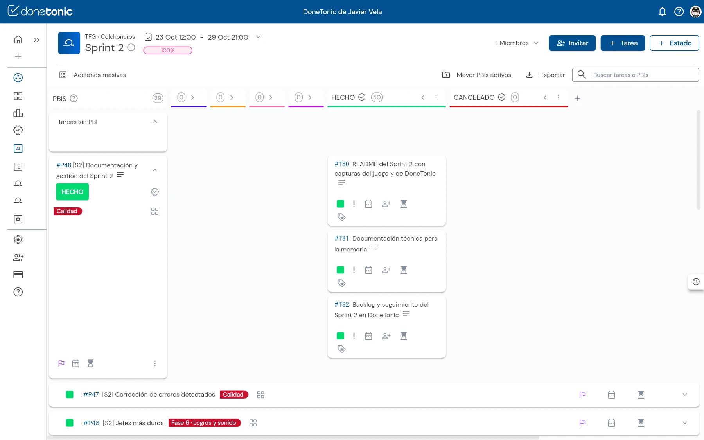
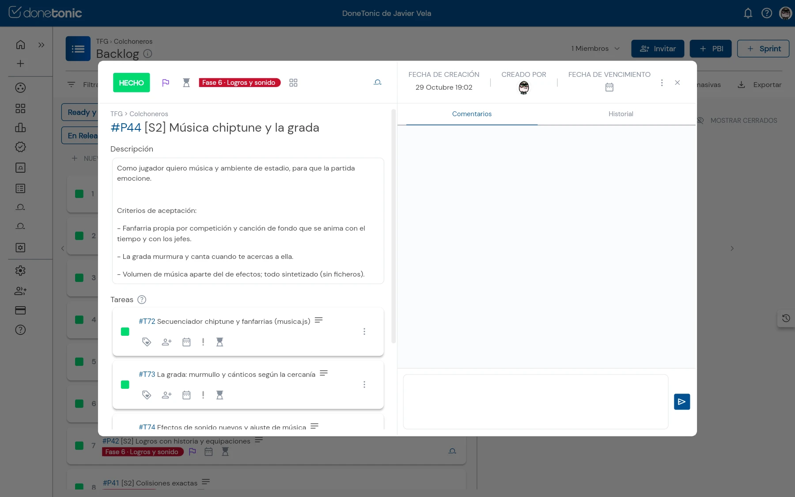
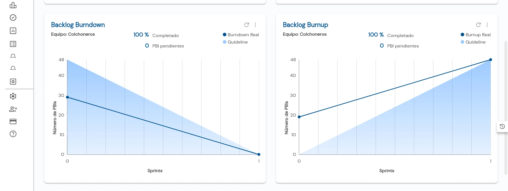
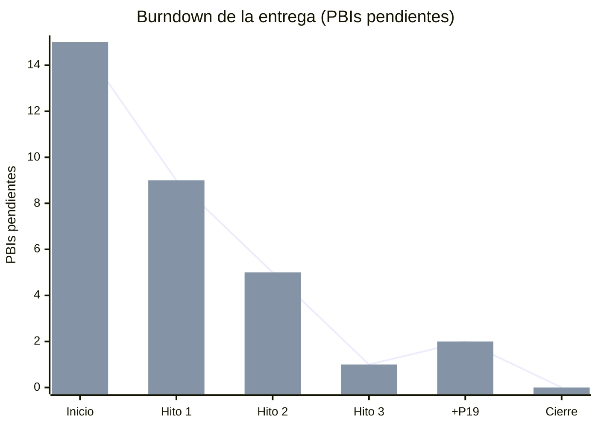
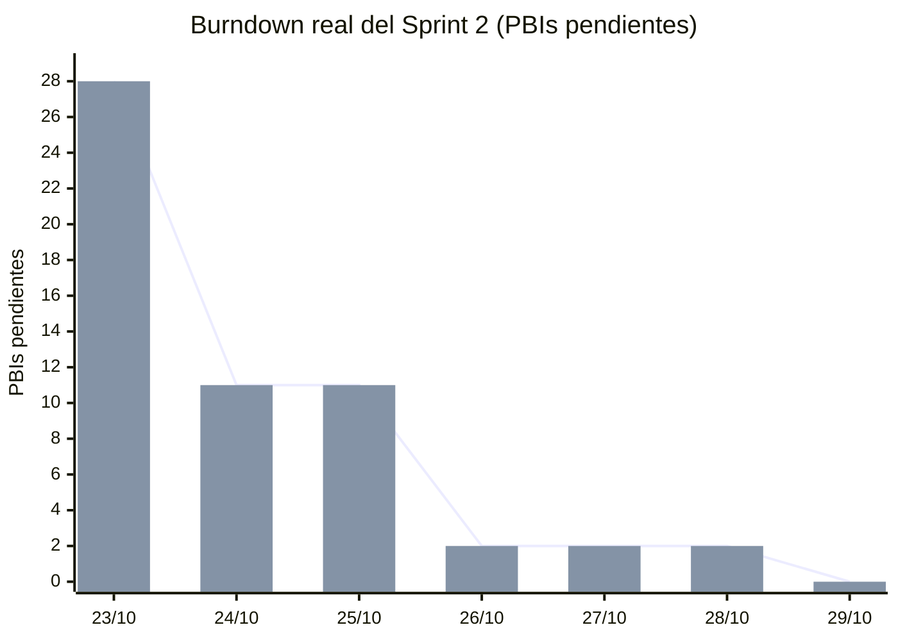

# Gestión del proyecto (DoneTonic)

Esta página reúne todo lo que se ha gestionado en **DoneTonic**, para que pueda revisarse desde el repositorio sin necesidad de entrar en la herramienta. Hay dos sprints: el **Sprint 1** (Hitos 1–4 del enunciado: la base SaaS) y el **Sprint 2** (la lógica del juego).

| Dato | Valor |
|---|---|
| Herramienta | [DoneTonic](https://app.donetonic.com) |
| Espacio de trabajo / equipo | *TFG* / *Colchoneros* |
| Sprint 1 | Del 29/09/2026 al 27/10/2026 · 19 PBIs (P1–P19) y 32 tareas (T1–T32), etiquetas *Hito 1* a *Hito 4* · **Hecho** |
| Sprint 2 | Del 23/10/2026 al 29/10/2026 · 29 PBIs (P20–P48) y 50 tareas (T33–T82), etiquetas por fase del juego · **Hecho** |
| Product Backlog | 48 PBIs y 82 tareas, todos hechos |
| Prioridad | Todos los PBIs son **MUST**: los del Sprint 1 son requisitos obligatorios del enunciado y los del Sprint 2 son la lógica del juego que pidió el profesor para este sprint |
| Capturas | Tomadas en DoneTonic el 29/10/2026, con los dos sprints cerrados |

## Índice

1. [Cómo se ha trabajado](#cómo-se-ha-trabajado) · [Definición de hecho](#definición-de-hecho-dod)
2. [Capturas de DoneTonic](#capturas-de-donetonic)
3. [Sprint 1: backlog, trazabilidad y evolución](#sprint-1-hitos-14)
4. [Sprint 2: backlog, historias de usuario, trazabilidad y evolución](#sprint-2-la-lógica-del-juego)

## Cómo se ha trabajado

1. **Del enunciado al backlog.** Cada requisito se convirtió en un PBI con una historia de usuario («Como … quiero … para …») y criterios de aceptación. En el Sprint 1 los requisitos venían del enunciado; en el Sprint 2, de la lógica del juego, agrupada por fases.
2. **Del PBI a las tareas.** Cada PBI se dividió en el menor número de tareas que tuviera sentido (entre una y tres).
3. **De la tarea al código.** En el Sprint 1 cada tarea tiene una rama propia `hito-N/Tx-descripcion` que se integra en la rama del hito mediante un PR `[Tx] ...`. En el Sprint 2 el trabajo se integró en `main` con **un PR por fase** del juego (#36, #44–#54), y cada tarea de DoneTonic indica en su descripción el PR donde está (`PR: #nn`).
4. **Integración y despliegue.** Todos los PRs exigen el CI en verde y, al llegar a `main`, la aplicación se despliega sola en Google Cloud Run.
5. **Seguimiento.** Al fusionar cada PR, su tarea pasa a *HECHO* en el tablero. Cuando todas las tareas de un PBI están hechas, el PBI pasa a *HECHO* automáticamente. Las gráficas de DoneTonic se actualizan solas.

### Definición de hecho (DoD)

Una tarea solo se considera **hecha** cuando cumple todo esto:

- el código está en un PR con la referencia a la tarea (en el título en el Sprint 1, en la descripción de la tarea en el Sprint 2);
- las pruebas automáticas pasan en el CI (check **Pruebas**), y las partes nuevas tienen sus propias pruebas;
- el PR está fusionado y desplegado en la URL pública (https://la-grada-colchonera-1081564062572.europe-southwest1.run.app);
- la documentación (README, `docs/`, `.env.example`) está actualizada si hace falta.

Un **hito** (Sprint 1) está hecho cuando su rama está en `main`, desplegada y publicada como release. Una **fase del juego** (Sprint 2) está hecha cuando su PR está en `main`, desplegado y probado a mano en el navegador.

## Capturas de DoneTonic

Capturas tomadas el 29/10/2026, con los dos sprints cerrados (*Hecho*).

**Product Backlog y Sprint Backlog.** A la izquierda, los PBIs priorizados con su etiqueta (los del Sprint 2 arriba). A la derecha, los dos sprints con sus fechas; el Sprint 1 está desplegado con sus PBIs.

### Sprint 1

**Tablero del Sprint 1** al 100 %: los 19 PBIs (P1–P19, etiquetas *Hito 1* a *Hito 4*) en verde, hechos.

**Sprint Burndown y Sprint Burnup del Sprint 1.** Los 19 PBIs completados. El escalón del burnup es el cambio de alcance (se añadió P19, Cloud Run) y el último tramo son los tres PBIs del Hito 4 (P15–P17).

### Sprint 2

**Tablero del Sprint 2** al 100 %: los 29 PBIs (P20–P48) con su etiqueta de fase.

**Tareas de un PBI.** P48 desplegado: sus tres tareas (T80–T82) en la columna *HECHO*, que suma las 50 tareas del sprint.

**Detalle de un PBI.** P44 con su historia de usuario, sus criterios de aceptación y sus tareas (T72–T74).

**Sprint Burndown y Sprint Burnup del Sprint 2.** Los 29 PBIs completados.

> **Sobre las gráficas del Sprint 2.** El juego se programó del 23 al 26/10, antes de que el profesor fijara que el Sprint 2 sería la lógica del juego. El backlog del Sprint 2 se registró en DoneTonic al cerrar el sprint (29/10), así que DoneTonic marca todos los PBIs como hechos ese día y sus gráficas salen como una recta. La evolución real, sacada de las fechas de los PRs, está en la [tabla de evolución del Sprint 2](#evolución-del-sprint-2).

**Backlog Burndown y Backlog Burnup.** El producto completo a lo largo de los dos sprints (48 PBIs).

## Sprint 1 (Hitos 1–4)

Del 29/09/2026 al 27/10/2026. Alcance: los Hitos 1, 2 y 3 (P1–P14), el Hito 4 (P15–P17), P18 (README y revisión) y P19 (despliegue en Google Cloud Run con los créditos de educación). La primera entrega (12/10/2026) se limitó a los Hitos 1–3, P18 y P19; el Hito 4 se completó el 23/10/2026.

### Backlog y estado del Sprint 1

| PBI | Hito | Título | Estado | Entrega |
|---|---|---|---|---|
| P1 | H1 | Repositorio GitHub y flujo GitHub Flow | Hecho | [hito-1](https://github.com/VelaElDios/la-grada-colchonera-saas/releases/tag/hito-1) |
| P2 | H1 | Integración continua (CI) | Hecho | [hito-1](https://github.com/VelaElDios/la-grada-colchonera-saas/releases/tag/hito-1) |
| P3 | H1 | Despliegue continuo en URL pública | Hecho | [hito-1](https://github.com/VelaElDios/la-grada-colchonera-saas/releases/tag/hito-1) |
| P4 | H1 | Lógica de gestión de usuarios (en memoria) | Hecho | [hito-1](https://github.com/VelaElDios/la-grada-colchonera-saas/releases/tag/hito-1) |
| P5 | H1 | Pruebas unitarias automatizadas de la lógica | Hecho | [hito-1](https://github.com/VelaElDios/la-grada-colchonera-saas/releases/tag/hito-1) |
| P6 | H1 | Capa API de usuarios | Hecho | [hito-1](https://github.com/VelaElDios/la-grada-colchonera-saas/releases/tag/hito-1) |
| P7 | H2 | Frontend: interfaz y cliente de comunicación separados | Hecho | [hito-2](https://github.com/VelaElDios/la-grada-colchonera-saas/releases/tag/hito-2) |
| P8 | H2 | Registro e inicio de sesión locales | Hecho | [hito-2](https://github.com/VelaElDios/la-grada-colchonera-saas/releases/tag/hito-2) |
| P9 | H2 | Cierre de sesión y mantenimiento de la sesión | Hecho | [hito-2](https://github.com/VelaElDios/la-grada-colchonera-saas/releases/tag/hito-2) |
| P10 | H2 | Rutas protegidas en el servidor | Hecho | [hito-2](https://github.com/VelaElDios/la-grada-colchonera-saas/releases/tag/hito-2) |
| P11 | H3 | Persistencia en base de datos real | Hecho | [hito-3](https://github.com/VelaElDios/la-grada-colchonera-saas/releases/tag/hito-3) |
| P12 | H3 | Gestión de secretos con variables de entorno | Hecho | [hito-3](https://github.com/VelaElDios/la-grada-colchonera-saas/releases/tag/hito-3) |
| P13 | H3 | Roles de usuario y administrador | Hecho | [hito-3](https://github.com/VelaElDios/la-grada-colchonera-saas/releases/tag/hito-3) |
| P14 | H3 | Registro (log) de la actividad | Hecho | [hito-3](https://github.com/VelaElDios/la-grada-colchonera-saas/releases/tag/hito-3) |
| P15 | H4 | Inicio de sesión con proveedor externo (OAuth) | Hecho | [hito-4](https://github.com/VelaElDios/la-grada-colchonera-saas/releases/tag/hito-4) · PR #40 |
| P16 | H4 | Confirmación de cuenta por correo electrónico | Hecho | [hito-4](https://github.com/VelaElDios/la-grada-colchonera-saas/releases/tag/hito-4) · PRs #38 y #39 |
| P17 | H4 | Manejo de errores y feedback al usuario | Hecho | [hito-4](https://github.com/VelaElDios/la-grada-colchonera-saas/releases/tag/hito-4) · PRs #37–#41 |
| P18 | H4 | README completo y revisión de la entrega | Hecho | Cierre del sprint |
| P19 | H4 | Despliegue continuo en Google Cloud Run | Hecho | Cierre del sprint |

> Aunque P17 (manejo de errores) es del Hito 4, la aplicación ya tenía parte de esa funcionalidad desde el Hito 1: un manejador de errores común con el formato `{"error": {"code", "message"}}` y mensajes de error y de éxito en la interfaz.

### Trazabilidad del Sprint 1: tarea → rama → pull request

| PBI | Tarea | Descripción | Rama | Pull request | Estado |
|---|---|---|---|---|---|
| P1 | T1 | Crear repositorio y estructura base | `hito-1/T1-estructura-base` | [#1](https://github.com/VelaElDios/la-grada-colchonera-saas/pull/1) | Hecho |
|  | T2 | Configurar GitHub Flow | `hito-1/T2-github-flow` | [#2](https://github.com/VelaElDios/la-grada-colchonera-saas/pull/2) | Hecho |
| P2 | T3 | Workflow de CI con GitHub Actions | `hito-1/T3-integracion-continua` | [#3](https://github.com/VelaElDios/la-grada-colchonera-saas/pull/3) | Hecho |
| P3 | T4 | Despliegue automático en proveedor cloud gratuito | `hito-1/T4-despliegue-continuo · hito-1/T4-url-publica` | [#4](https://github.com/VelaElDios/la-grada-colchonera-saas/pull/4) · [#10](https://github.com/VelaElDios/la-grada-colchonera-saas/pull/10) | Hecho |
| P4 | T5 | Modelo de usuario y repositorio en memoria | `hito-1/T5-modelo-repositorio-memoria` | [#5](https://github.com/VelaElDios/la-grada-colchonera-saas/pull/5) | Hecho |
|  | T6 | Servicio de gestión de usuarios | `hito-1/T6-servicio-usuarios` | [#6](https://github.com/VelaElDios/la-grada-colchonera-saas/pull/6) | Hecho |
| P5 | T7 | Framework de pruebas y al menos 5 pruebas | `hito-1/T7-pruebas-unitarias` | [#7](https://github.com/VelaElDios/la-grada-colchonera-saas/pull/7) | Hecho |
| P6 | T8 | Endpoints de la API de usuarios | `hito-1/T8-api-usuarios` | [#8](https://github.com/VelaElDios/la-grada-colchonera-saas/pull/8) | Hecho |
| P7 | T9 | Cliente de comunicación con la API | `hito-2/T9-cliente-api` | [#11](https://github.com/VelaElDios/la-grada-colchonera-saas/pull/11) | Hecho |
|  | T10 | Interfaz de usuario: vistas y navegación | `hito-2/T10-vistas-navegacion` | [#12](https://github.com/VelaElDios/la-grada-colchonera-saas/pull/12) | Hecho |
| P8 | T11 | Registro y login en el backend (con hash) | `hito-2/T11-registro-login-backend` | [#13](https://github.com/VelaElDios/la-grada-colchonera-saas/pull/13) | Hecho |
|  | T12 | Formularios de registro y login en el frontend | `hito-2/T12-formularios-frontend` | [#14](https://github.com/VelaElDios/la-grada-colchonera-saas/pull/14) | Hecho |
| P9 | T13 | Mantener la sesión al recargar y cerrar sesión | `hito-2/T13-gestion-sesion` | [#15](https://github.com/VelaElDios/la-grada-colchonera-saas/pull/15) | Hecho |
| P10 | T14 | Middleware de autenticación y protección de rutas | `hito-2/T14-rutas-protegidas` | [#16](https://github.com/VelaElDios/la-grada-colchonera-saas/pull/16) | Hecho |
| P11 | T15 | Elegir y configurar la base de datos | `hito-3/T15-configurar-bd` | [#18](https://github.com/VelaElDios/la-grada-colchonera-saas/pull/18) | Hecho |
|  | T16 | Repositorio de BD sustituyendo al de memoria | `hito-3/T16-repositorio-postgres` | [#19](https://github.com/VelaElDios/la-grada-colchonera-saas/pull/19) | Hecho |
| P12 | T17 | Sacar los secretos a variables de entorno | `hito-3/T17-secretos-entorno` | [#20](https://github.com/VelaElDios/la-grada-colchonera-saas/pull/20) | Hecho |
| P13 | T18 | Roles, autorización y primer administrador (backend) | `hito-3/T18-roles-autorizacion` | [#21](https://github.com/VelaElDios/la-grada-colchonera-saas/pull/21) | Hecho |
|  | T19 | Panel de administración y baja de cuenta (frontend) | `hito-3/T19-panel-admin` | [#22](https://github.com/VelaElDios/la-grada-colchonera-saas/pull/22) | Hecho |
| P14 | T20 | Configurar el logging de la actividad relevante | `hito-3/T20-logging` | [#23](https://github.com/VelaElDios/la-grada-colchonera-saas/pull/23) | Hecho |
| P15 | T21 | Registrar la aplicación OAuth en Google | `hito-4/T22-google-oauth` (y configuración en Google Cloud, ver [`hito4-configuracion.md`](../hito4-configuracion.md)) | [#40](https://github.com/VelaElDios/la-grada-colchonera-saas/pull/40) | Hecho |
|  | T22 | Flujo de inicio de sesión con OAuth | `hito-4/T22-google-oauth` | [#40](https://github.com/VelaElDios/la-grada-colchonera-saas/pull/40) | Hecho |
| P16 | T23 | Servicio de correo | `hito-4/T23-correo` | [#38](https://github.com/VelaElDios/la-grada-colchonera-saas/pull/38) | Hecho |
|  | T24 | Flujo de confirmación de la cuenta | `hito-4/T24-confirmacion` | [#39](https://github.com/VelaElDios/la-grada-colchonera-saas/pull/39) | Hecho |
| P17 | T25 | Errores en el backend | `hito-4/T25-secretos-hito4` y el resto de ramas del hito | [#37](https://github.com/VelaElDios/la-grada-colchonera-saas/pull/37)–[#41](https://github.com/VelaElDios/la-grada-colchonera-saas/pull/41) | Hecho |
|  | T26 | Mensajes de error en el frontend | `hito-4/T26-privacidad` y el resto de ramas del hito | [#37](https://github.com/VelaElDios/la-grada-colchonera-saas/pull/37)–[#41](https://github.com/VelaElDios/la-grada-colchonera-saas/pull/41) | Hecho |
| P18 | T27 | Completar el README | `hito-4/T27-readme-completo` | [#25](https://github.com/VelaElDios/la-grada-colchonera-saas/pull/25) | Hecho |
|  | T28 | Etiquetas de hito y revisión final | `hito-4/T28-revision-entrega` | [#26](https://github.com/VelaElDios/la-grada-colchonera-saas/pull/26) | Hecho |
|  | T31 | Revisión frase a frase contra el enunciado y README final | `hito-4/T31-revision-enunciado` | [#30](https://github.com/VelaElDios/la-grada-colchonera-saas/pull/30) | Hecho |
|  | T32 | Carpeta de la memoria en LuaLaTeX | `hito-4/T32-carpeta-memoria` | [#31](https://github.com/VelaElDios/la-grada-colchonera-saas/pull/31) | Hecho |
| P19 | T29 | Contenerizar la aplicación con Docker | `hito-4/T29-docker` | [#27](https://github.com/VelaElDios/la-grada-colchonera-saas/pull/27) | Hecho |
|  | T30 | Despliegue continuo en Cloud Run con GitHub Actions | `hito-4/T30-cloud-run` | [#28](https://github.com/VelaElDios/la-grada-colchonera-saas/pull/28) | Hecho |

Cierres de hito: [#9](https://github.com/VelaElDios/la-grada-colchonera-saas/pull/9) (Hito 1 → `main`), [#17](https://github.com/VelaElDios/la-grada-colchonera-saas/pull/17) (Hito 2 → `main`), [#24](https://github.com/VelaElDios/la-grada-colchonera-saas/pull/24) (Hito 3 → `main`) [#29](https://github.com/VelaElDios/la-grada-colchonera-saas/pull/29) (cierre del sprint → `main`) y [#32](https://github.com/VelaElDios/la-grada-colchonera-saas/pull/32) (revisión final y memoria → `main`).

> **Hito 4.** En DoneTonic las tareas del Hito 4 se llaman por lo que hacen (T21 *Registrar app OAuth*, T22 *Flujo login OAuth*, T23 *Servicio correo*, T24 *Flujo confirmación*, T25 *Errores backend* y T26 *Mensajes frontend*). En el repositorio el trabajo se repartió en cinco ramas (`hito-4/T22-google-oauth` #40, `T23-correo` #38, `T24-confirmacion` #39, `T25-secretos-hito4` #37 y `T26-privacidad` #41). El manejo de errores (P17) está repartido por las cinco. Las seis tareas se marcaron como hechas en DoneTonic al cerrar el Sprint 1.

### Evolución del Sprint 1

PBIs pendientes del alcance de la entrega (P1–P14, P18 y P19; 16 en total) según se cerraba cada hito. Es lo que muestran las gráficas *Backlog Burndown* y *Sprint Burndown* de DoneTonic:

| Momento | PBIs hechos | PBIs pendientes |
|---|---|---|
| Inicio del Sprint 1 (29/09/2026) | 0 | 15 |
| Cierre del Hito 1 (release `hito-1`) | 6 | 9 |
| Cierre del Hito 2 (release `hito-2`) | 10 | 5 |
| Cierre del Hito 3 (release `hito-3`) | 14 | 1 |
| Se añade P19 (Cloud Run) para usar los créditos de Google Cloud | 14 | 2 |
| Cierre del sprint (P18 y P19) | 16 | 0 |

> **Cambio de alcance durante el sprint:** el profesor repartió créditos de Google Cloud para educación. Para aprovecharlos se añadió al sprint el PBI **P19** (despliegue en Google Cloud Run), con sus tareas T29 y T30. Render se mantiene como despliegue alternativo.

## Sprint 2 (la lógica del juego)

Del 23/10/2026 al 29/10/2026. Cerrado el Sprint 1, el profesor fijó que el **Sprint 2 es la lógica del juego**. El juego ya estaba hecho, en seis fases, así que el sprint recoge ese trabajo como backlog: 29 PBIs (P20–P48) y 50 tareas (T33–T82), con una etiqueta por fase.

### Etiquetas

| Etiqueta | PBIs | Qué agrupa |
|---|---|---|
| Base del juego | P20–P28 | Interfaz rediseñada, motor survivor, pixel art, jugadores, armas, rivales, jefes, mapa y controles |
| Fase 2 · Club | P29–P32 | Progreso en el servidor, contratos, entrenamiento y ranking |
| Fase 3 · Ultras | P33–P34 | Combinaciones, ULTRAS, dificultad y modo pruebas |
| Fase 4 · Mundo | P35–P37 | Mundo procedural, ambientes por finales, mote y avatar |
| Fase 5 · Rarezas | P38–P41 | Rarezas por historia, habilidades niveladas, combinaciones a la vista y colisiones |
| Fase 6 · Logros y sonido | P42–P46 | Logros, pantalla de fin, música y grada, muñecos y jefes |
| Calidad | P47–P48 | Errores corregidos, documentación y gestión |

### Backlog y estado del Sprint 2

«Hecho» es el día en que se fusionó en `main` el último PR del PBI.

| PBI | Etiqueta | Título | Tareas | PRs | Hecho | Estado |
|---|---|---|---|---|---|---|
| P20 | Base del juego | Rediseño de la interfaz web y menú del juego | T33, T34 | #36, #45 | 24/10/2026 | Hecho |
| P21 | Base del juego | Motor de la partida survivor | T35, T36 | #36 | 23/10/2026 | Hecho |
| P22 | Base del juego | Gráficos pixel art y cámara 3/4 | T37, T38 | #44, #46 | 24/10/2026 | Hecho |
| P23 | Base del juego | Jugadores, entrenadores y Vestuario | T39–T41 | #44, #48 | 24/10/2026 | Hecho |
| P24 | Base del juego | Armas, habilidades y mejoras | T42, T43 | #36, #48 | 24/10/2026 | Hecho |
| P25 | Base del juego | Rivales con comportamiento propio | T44, T45 | #44, #45, #47 | 24/10/2026 | Hecho |
| P26 | Base del juego | Jefes con fases | T46, T47 | #45, #48 | 24/10/2026 | Hecho |
| P27 | Base del juego | Mapa con terreno y obstáculos | T48, T49 | #45, #47 | 24/10/2026 | Hecho |
| P28 | Base del juego | Controles, pantalla completa y ajustes | T50, T51 | #36, #47 | 24/10/2026 | Hecho |
| P29 | Fase 2 · Club | Progreso del juego guardado en el servidor | T52, T53 | #49 | 24/10/2026 | Hecho |
| P30 | Fase 2 · Club | Contratos: fichar jugadores | T54 | #49 | 24/10/2026 | Hecho |
| P31 | Fase 2 · Club | Entrenamiento de jugadores | T55 | #49, #50 | 24/10/2026 | Hecho |
| P32 | Fase 2 · Club | Ranking de la grada | T56 | #49 | 24/10/2026 | Hecho |
| P33 | Fase 3 · Ultras | Combinaciones y ULTRAS | T57, T58 | #50 | 24/10/2026 | Hecho |
| P34 | Fase 3 · Ultras | Dificultad equilibrada y modo pruebas | T59, T60 | #50 | 24/10/2026 | Hecho |
| P35 | Fase 4 · Mundo | Mundo procedural natural | T61 | #52 | 24/10/2026 | Hecho |
| P36 | Fase 4 · Mundo | Ambientes por finales | T62 | #52 | 24/10/2026 | Hecho |
| P37 | Fase 4 · Mundo | Mote y avatar | T63 | #52 | 24/10/2026 | Hecho |
| P38 | Fase 5 · Rarezas | Rarezas por historia rojiblanca y fichajes | T64, T65 | #53 | 26/10/2026 | Hecho |
| P39 | Fase 5 · Rarezas | Habilidades niveladas por minuto | T66 | #53 | 26/10/2026 | Hecho |
| P40 | Fase 5 · Rarezas | Combinaciones y ultras a la vista | T67 | #53 | 26/10/2026 | Hecho |
| P41 | Fase 5 · Rarezas | Colisiones exactas | T68 | #53 | 26/10/2026 | Hecho |
| P42 | Fase 6 · Logros y sonido | Logros con historia y equipaciones | T69, T70 | #54 | 26/10/2026 | Hecho |
| P43 | Fase 6 · Logros y sonido | Pantalla de fin con estadísticas | T71 | #54 | 26/10/2026 | Hecho |
| P44 | Fase 6 · Logros y sonido | Música chiptune y la grada | T72–T74 | #54 | 26/10/2026 | Hecho |
| P45 | Fase 6 · Logros y sonido | Muñecos con más detalle | T75 | #54 | 26/10/2026 | Hecho |
| P46 | Fase 6 · Logros y sonido | Jefes más duros | T76 | #54 | 26/10/2026 | Hecho |
| P47 | Calidad | Corrección de errores detectados | T77–T79 | #51, #55, #56 | 29/10/2026 | Hecho |
| P48 | Calidad | Documentación y gestión del Sprint 2 | T80–T82 | #55 | 29/10/2026 | Hecho |

### Historias de usuario y criterios de aceptación

Cada PBI del Sprint 2 tiene en DoneTonic su historia de usuario y sus criterios de aceptación. Son estos:

Ver las 29 historias de usuario con sus criterios

- **P20 · Rediseño de la interfaz web y menú del juego** (Base del juego). Como aficionado quiero una web con aspecto de juego, clara en el móvil y en el ordenador, para que entrar a jugar sea lo primero que vea al iniciar sesión.
  - Sistema de diseño propio (colores, espacios, tipografía Plus Jakarta Sans) en tokens CSS reutilizables.
  - Modo oscuro rojiblanco en toda la web y diseño responsive.
  - Con sesión iniciada el inicio es el menú del juego; la cabecera solo muestra Jugar y Mi cuenta (y Administración al admin).
  - Las pantallas de cuentas del Sprint 1 siguen funcionando igual (pruebas en verde).
- **P21 · Motor de la partida survivor** (Base del juego). Como jugador quiero una partida de supervivencia contra oleadas infinitas, en la que mis armas ataquen solas y yo solo tenga que moverme y elegir mejoras.
  - Simulación pura (sin DOM) con paso fijo de 1/60 s y azar con semilla: misma semilla, misma partida.
  - Oleadas cada 30 s, experiencia al eliminar rivales y elección de 1 de 3 mejoras al subir de nivel.
  - Dificultad que crece sin parar (vida, daño y velocidad de los rivales).
  - Pausa, fin de partida y vuelta al menú; la partida se pausa al cambiar de pestaña.
- **P22 · Gráficos pixel art y cámara 3/4** (Base del juego). Como jugador quiero un estilo visual propio y reconocible, con muñecos «chibi» del Atleti, para que el juego tenga personalidad sin usar imágenes oficiales.
  - Muñecos de 16×20 píxeles dibujados con código (sin imágenes), con caché de fotogramas.
  - Cámara 3/4 con inercia, inclinación al correr, destellos y aplastado al recibir golpes.
  - Se respeta prefers-reduced-motion (sin sacudidas ni partículas).
- **P23 · Jugadores, entrenadores y Vestuario** (Base del juego). Como jugador quiero elegir entre leyendas del Atleti y un entrenador, cada uno con su estilo, para que cada partida se juegue distinto.
  - Estadísticas por posición (portero, defensa, medio, delantero) retocadas por los rasgos de cada jugador.
  - Cada jugador solo puede aprender las habilidades que encajan con su forma de jugar.
  - Dos entrenadores (Simeone y Luis Aragonés) con bonificaciones y una ulti propia.
  - Vestuario con filtro por posición y ficha del jugador.
- **P24 · Armas, habilidades y mejoras** (Base del juego). Como jugador quiero muchas armas y habilidades que suban de nivel y se puedan combinar, para construir una estrategia distinta en cada partida.
  - Armas de disparo y cuerpo a cuerpo que atacan solas, con 5 niveles.
  - Pasivas (botas, imán, pasión…) y mejoras extra sin límite cuando todo está al máximo.
  - Los porteros no aprenden armas de disparo.
- **P25 · Rivales con comportamiento propio** (Base del juego). Como jugador quiero rivales variados que me obliguen a moverme, para que la partida no sea solo aguantar en un sitio.
  - 16 equipos con jugadores genéricos que se desbloquean por oleadas.
  - Unos embisten avisando con un «!» y otros disparan balones.
  - Los rivales rodean gradas y paredes para llegar al jugador.
- **P26 · Jefes con fases** (Base del juego). Como jugador quiero jefes famosos con ataques propios cada pocas oleadas, para tener retos claros dentro de la partida.
  - Un jefe cada 4 oleadas, al azar entre los disponibles y sin repetir hasta que salgan todos.
  - Tres fases por vida (66 % y 33 %): más ataques, menos espera y más velocidad.
  - Cada ataque fuerte se avisa en el suelo antes de golpear.
- **P27 · Mapa con terreno y obstáculos** (Base del juego). Como jugador quiero un campo con barro, lluvia, gradas y estructuras, para que moverse por el mapa sea parte del juego.
  - Barro que frena, lluvia que acelera los balones y gradas que no se atraviesan.
  - Mapa procedural con biomas y estructuras distinto en cada partida.
  - Premios por el campo señalados con flechas en el borde de la pantalla.
- **P28 · Controles, pantalla completa y ajustes** (Base del juego). Como jugador quiero jugar con teclado o con el dedo y ajustar el sonido y los gráficos, para jugar cómodo en cualquier dispositivo.
  - Teclado (WASD/flechas) y joystick táctil flotante en el móvil.
  - Pantalla completa (botón y tecla F) y menú de pausa con ajustes dentro de la partida.
  - Ajustes guardados en el navegador: volumen, efectos, números de daño, zoom y joystick.
- **P29 · Progreso del juego guardado en el servidor** (Fase 2 · Club). Como jugador quiero que mi club y mis partidas se guarden en mi cuenta, para no perder el progreso al cambiar de dispositivo.
  - Tablas juego_perfiles y juego_records (migración 003) ligadas al usuario.
  - API /api/juego protegida con sesión: perfil, empezar y terminar partida.
  - El servidor valida cada resultado con su propio reloj (anti-trampas) y rechaza resultados imposibles.
  - Concurrencia optimista: dos peticiones a la vez no se pisan.
- **P30 · Contratos: fichar jugadores** (Fase 2 · Club). Como jugador quiero ganar fichas de contrato venciendo jefes y canjearlas por jugadores nuevos, para ampliar mi plantilla.
  - Plantilla inicial de 4 jugadores comunes (uno por posición).
  - Una ficha por cada 3 jefes vencidos en la cuenta; el contrato nunca repite jugador.
  - La probabilidad depende de la rareza del jugador.
- **P31 · Entrenamiento de jugadores** (Fase 2 · Club). Como jugador quiero entrenar a mis jugadores con los puntos que ganan, para que mejoren partida a partida.
  - Puntos por jefes (1 cada 3 con ese jugador) y por bajas (cada vez más caros).
  - Cuatro estadísticas (Vida, Defensa, Disparo y Suerte) hasta 20 puntos.
  - Solo se gastan puntos libres; validado en el servidor.
- **P32 · Ranking de la grada** (Fase 2 · Club). Como jugador quiero compararme con el resto de aficionados, para tener un motivo para mejorar mi marca.
  - Una fila por usuario con su mejor partida (tiempo; en empate, nivel).
  - Nunca se muestra el correo de nadie.
  - Pestañas Mis partidas y La grada.
- **P33 · Combinaciones y ULTRAS** (Fase 3 · Ultras). Como jugador quiero que juntar ciertas habilidades desbloquee combinaciones y poderes definitivos, para premiar las estrategias pensadas.
  - 24 combinaciones con nombre propio y bonus.
  - 6 ULTRAS que se consiguen solas al completar combinaciones (Premio Puskás, Balón de Oro, Zamora…).
  - Efecto visual propio y daño en parte porcentual (reducido contra jefes).
- **P34 · Dificultad equilibrada y modo pruebas** (Fase 3 · Ultras). Como jugador quiero que el juego sea difícil pero justo, y como administrador quiero poder probarlo todo sin jugar horas.
  - Tramo final más duro desde el minuto 9 y rivales curtidos desde el 12.
  - Ayuda inicial que se apaga en 8 minutos para poder vencer al primer jefe.
  - Modo pruebas (solo admin): todos los jugadores y puntos sin tocar el ranking.
- **P35 · Mundo procedural natural** (Fase 4 · Mundo). Como jugador quiero un mundo distinto en cada partida, con barrios, estadios, parques y mesetas, para que explorar tenga gracia.
  - Ruidos suaves para distrito, altura y humedad: todo encaja sin cortes.
  - Estadios con gradas que miran al campo, plazas con tiendas, mesetas con escaleras.
  - Casi todo el mapa es alcanzable desde la salida (con pruebas).
- **P36 · Ambientes por finales** (Fase 4 · Mundo). Como jugador quiero que cada 5 minutos la partida cambie de escenario, para sentir que avanzo de final en final.
  - Pretemporada → Copa del Rey → Liga → Champions → Mundial.
  - Cambian la luz, el césped, la afición y los carteles; los rivales salen más fuertes.
  - En el Mundial todos llevan la camiseta de su selección.
- **P37 · Mote y avatar** (Fase 4 · Mundo). Como jugador quiero un mote y una cara propios, para que en el ranking y en la cabecera no salga mi correo.
  - Mote de 3 a 16 caracteres, único sin distinguir mayúsculas ni tildes (409 si está cogido).
  - Avatar con la cara de un jugador fichado o de un entrenador.
  - Migración 004 y PUT /api/juego/identidad.
- **P38 · Rarezas por historia rojiblanca y fichajes** (Fase 5 · Rarezas). Como aficionado quiero que la rareza de cada jugador refleje lo que fue en el Atleti, y que fichar se sienta especial.
  - 36 jugadores en cuatro rarezas (Común, Raro, Épico, Leyenda) según su historia en el club.
  - Más rareza = más habilidades aprendibles y menos probabilidad en un contrato.
  - Animación de la firma del contrato en pixel art.
- **P39 · Habilidades niveladas por minuto** (Fase 5 · Rarezas). Como jugador quiero que las habilidades más fuertes no rompan la partida al principio.
  - Niveles que no salen hasta cierto minuto (desdeMinuto) y recarga mínima (cdMin).
  - Regate, entrada rasante y contragolpe reequilibrados.
- **P40 · Combinaciones y ultras a la vista** (Fase 5 · Rarezas). Como jugador quiero ver qué combinaciones y ultras existen y qué me falta, para planificar la partida.
  - Pantalla Combinaciones con nombre, bonus, requisitos y ultra a la que cuentan.
  - Filtros Todas / Con tu jugador / Conseguidas.
- **P41 · Colisiones exactas** (Fase 5 · Rarezas). Como jugador quiero que lo que veo sea lo que choca, para que nadie se esconda detrás de un tejado.
  - Edificios, gradas y bancos chocan en todo su dibujo.
  - Los muñecos chocan por los pies (vista 3/4); la copa de los árboles se vuelve transparente.
- **P42 · Logros con historia y equipaciones** (Fase 6 · Logros y sonido). Como aficionado quiero logros con datos curiosos del Atleti que desbloqueen equipaciones, para tener objetivos a largo plazo.
  - 29 logros con un dato real que se descubre al conseguirlo.
  - El servidor solo apunta los logros que puede comprobar.
  - 10 equipaciones que se eligen en el Vestuario.
- **P43 · Pantalla de fin con estadísticas** (Fase 6 · Logros y sonido). Como jugador quiero ver al final de la partida qué ha funcionado, para mejorar en la siguiente.
  - Tiempo, ambiente, bajas, jefes, daño total, golpe máximo, críticos, daño recibido y vida recuperada.
  - Barras de daño por habilidad (armas, ultras, ulti y quemaduras).
  - Jefes vencidos con lo que costaron y logros nuevos.
- **P44 · Música chiptune y la grada** (Fase 6 · Logros y sonido). Como jugador quiero música y ambiente de estadio, para que la partida emocione.
  - Fanfarria propia por competición y canción de fondo que se anima con el tiempo y con los jefes.
  - La grada murmura y canta cuando te acercas a ella.
  - Volumen de música aparte del de efectos; todo sintetizado (sin ficheros).
- **P45 · Muñecos con más detalle** (Fase 6 · Logros y sonido). Como aficionado quiero reconocer a los jugadores y a los jefes en el campo.
  - Sombreado, orejas, nariz y peinados nuevos.
  - Rasgos propios: brazalete de capitán, cinta, pecas, barba, pendientes, tatuajes.
- **P46 · Jefes más duros** (Fase 6 · Logros y sonido). Como jugador quiero que los jefes sean un reto de verdad a partir del segundo.
  - Escolta de élites desde el segundo jefe y refuerzos al cambiar de fase.
  - Furia si tardas en ganarles.
  - Una jugada estrella por jefe en la fase 3; el primero sigue siendo asequible.
- **P47 · Corrección de errores detectados** (Calidad). Como usuario quiero que los errores que encuentren los probadores se arreglen con pruebas que eviten que vuelvan.
  - Cada error se reproduce con una prueba antes de arreglarlo.
  - Los arreglos pasan el CI y se despliegan.
- **P48 · Documentación y gestión del Sprint 2** (Calidad). Como responsable del proyecto quiero que todo el Sprint 2 se pueda revisar desde el repositorio.
  - README con capturas del juego y de DoneTonic.
  - Documentación técnica para la memoria con diagramas.
  - Backlog, tablero y gráficas del Sprint 2 en DoneTonic.

### Trazabilidad del Sprint 2: tarea → pull request

Las tareas de cada PBI indican en su descripción de DoneTonic el PR donde está el trabajo.

| PBI | Tarea | Descripción | Pull request | Estado |
|---|---|---|---|---|
| P20 | T33 | Sistema de diseño: tokens, tipografía y modo oscuro rojiblanco | [#36](https://github.com/VelaElDios/la-grada-colchonera-saas/pull/36) | Hecho |
|  | T34 | Menú del juego como inicio con sesión (hub con el jugador paseando) | [#36](https://github.com/VelaElDios/la-grada-colchonera-saas/pull/36) · [#45](https://github.com/VelaElDios/la-grada-colchonera-saas/pull/45) | Hecho |
| P21 | T35 | Simulación de paso fijo con semilla (mundo.js) | [#36](https://github.com/VelaElDios/la-grada-colchonera-saas/pull/36) | Hecho |
|  | T36 | Oleadas, experiencia y mejoras al subir de nivel | [#36](https://github.com/VelaElDios/la-grada-colchonera-saas/pull/36) | Hecho |
| P22 | T37 | Muñecos chibi generados por código (sprites.js) | [#44](https://github.com/VelaElDios/la-grada-colchonera-saas/pull/44) | Hecho |
|  | T38 | Cámara 3/4, inercia y sensación de movimiento y golpes | [#46](https://github.com/VelaElDios/la-grada-colchonera-saas/pull/46) | Hecho |
| P23 | T39 | Jugadores con estadísticas por posición y habilidades propias | [#44](https://github.com/VelaElDios/la-grada-colchonera-saas/pull/44) · [#48](https://github.com/VelaElDios/la-grada-colchonera-saas/pull/48) | Hecho |
|  | T40 | Entrenadores con ulti y pantalla Dirección | [#44](https://github.com/VelaElDios/la-grada-colchonera-saas/pull/44) | Hecho |
|  | T41 | Vestuario renovado con filtros y ficha | [#48](https://github.com/VelaElDios/la-grada-colchonera-saas/pull/48) | Hecho |
| P24 | T42 | Armas con 5 niveles: disparo, cuerpo a cuerpo y movilidad | [#36](https://github.com/VelaElDios/la-grada-colchonera-saas/pull/36) · [#48](https://github.com/VelaElDios/la-grada-colchonera-saas/pull/48) | Hecho |
|  | T43 | Pasivas y mejoras extra | [#36](https://github.com/VelaElDios/la-grada-colchonera-saas/pull/36) | Hecho |
| P25 | T44 | 16 equipos rivales que se desbloquean por oleadas | [#44](https://github.com/VelaElDios/la-grada-colchonera-saas/pull/44) | Hecho |
|  | T45 | Rivales que embisten, disparan y rodean obstáculos | [#45](https://github.com/VelaElDios/la-grada-colchonera-saas/pull/45) · [#47](https://github.com/VelaElDios/la-grada-colchonera-saas/pull/47) | Hecho |
| P26 | T46 | Jefes con tres fases y avisos de ataque | [#45](https://github.com/VelaElDios/la-grada-colchonera-saas/pull/45) | Hecho |
|  | T47 | Seis jefes nuevos con habilidades propias | [#48](https://github.com/VelaElDios/la-grada-colchonera-saas/pull/48) | Hecho |
| P27 | T48 | Barro, lluvia, gradas y premios | [#45](https://github.com/VelaElDios/la-grada-colchonera-saas/pull/45) | Hecho |
|  | T49 | Mapa procedural con biomas y estructuras | [#47](https://github.com/VelaElDios/la-grada-colchonera-saas/pull/47) | Hecho |
| P28 | T50 | Entrada por teclado y joystick táctil | [#36](https://github.com/VelaElDios/la-grada-colchonera-saas/pull/36) | Hecho |
|  | T51 | Pantalla completa, pausa y ajustes en partida | [#47](https://github.com/VelaElDios/la-grada-colchonera-saas/pull/47) | Hecho |
| P29 | T52 | Migración 003 y repositorios del juego (memoria y PostgreSQL) | [#49](https://github.com/VelaElDios/la-grada-colchonera-saas/pull/49) | Hecho |
|  | T53 | API del juego con validación anti-trampas | [#49](https://github.com/VelaElDios/la-grada-colchonera-saas/pull/49) | Hecho |
| P30 | T54 | Fichas por jefes y sorteo de contratos por rareza | [#49](https://github.com/VelaElDios/la-grada-colchonera-saas/pull/49) | Hecho |
| P31 | T55 | Puntos y estadísticas de entrenamiento | [#49](https://github.com/VelaElDios/la-grada-colchonera-saas/pull/49) · [#50](https://github.com/VelaElDios/la-grada-colchonera-saas/pull/50) | Hecho |
| P32 | T56 | Ranking multijugador con la mejor partida de cada usuario | [#49](https://github.com/VelaElDios/la-grada-colchonera-saas/pull/49) | Hecho |
| P33 | T57 | Combinaciones con nombre y bonus | [#50](https://github.com/VelaElDios/la-grada-colchonera-saas/pull/50) | Hecho |
|  | T58 | Seis ULTRAS con efectos visuales | [#50](https://github.com/VelaElDios/la-grada-colchonera-saas/pull/50) | Hecho |
| P34 | T59 | Curvas de dificultad calibradas con un bot | [#50](https://github.com/VelaElDios/la-grada-colchonera-saas/pull/50) | Hecho |
|  | T60 | Modo pruebas para administradores | [#50](https://github.com/VelaElDios/la-grada-colchonera-saas/pull/50) | Hecho |
| P35 | T61 | Generación del terreno por ruidos (terreno.js) | [#52](https://github.com/VelaElDios/la-grada-colchonera-saas/pull/52) | Hecho |
| P36 | T62 | Cinco ambientes con cambio de luz, afición y fuerza | [#52](https://github.com/VelaElDios/la-grada-colchonera-saas/pull/52) | Hecho |
| P37 | T63 | Migración 004, API de identidad y pantalla Tu ficha | [#52](https://github.com/VelaElDios/la-grada-colchonera-saas/pull/52) | Hecho |
| P38 | T64 | Rarezas por historia y 36 jugadores | [#53](https://github.com/VelaElDios/la-grada-colchonera-saas/pull/53) | Hecho |
|  | T65 | Animación de la firma del contrato | [#53](https://github.com/VelaElDios/la-grada-colchonera-saas/pull/53) | Hecho |
| P39 | T66 | Niveles bloqueados por minuto y recarga mínima | [#53](https://github.com/VelaElDios/la-grada-colchonera-saas/pull/53) | Hecho |
| P40 | T67 | Pantalla de combinaciones y ultras con filtros | [#53](https://github.com/VelaElDios/la-grada-colchonera-saas/pull/53) | Hecho |
| P41 | T68 | Hitbox por los pies y obstáculos macizos | [#53](https://github.com/VelaElDios/la-grada-colchonera-saas/pull/53) | Hecho |
| P42 | T69 | Logros validados en el servidor (logros.js) | [#54](https://github.com/VelaElDios/la-grada-colchonera-saas/pull/54) | Hecho |
|  | T70 | Pantalla Logros y equipaciones en el Vestuario | [#54](https://github.com/VelaElDios/la-grada-colchonera-saas/pull/54) | Hecho |
| P43 | T71 | Atribución del daño por fuente y pantalla de fin (fin-ui.js) | [#54](https://github.com/VelaElDios/la-grada-colchonera-saas/pull/54) | Hecho |
| P44 | T72 | Secuenciador chiptune y fanfarrias (musica.js) | [#54](https://github.com/VelaElDios/la-grada-colchonera-saas/pull/54) | Hecho |
|  | T73 | La grada: murmullo y cánticos según la cercanía | [#54](https://github.com/VelaElDios/la-grada-colchonera-saas/pull/54) | Hecho |
|  | T74 | Efectos de sonido nuevos y ajuste de música | [#54](https://github.com/VelaElDios/la-grada-colchonera-saas/pull/54) | Hecho |
| P45 | T75 | Rasgos y sombreado en sprites.js | [#54](https://github.com/VelaElDios/la-grada-colchonera-saas/pull/54) | Hecho |
| P46 | T76 | Escolta, furia y jugada estrella | [#54](https://github.com/VelaElDios/la-grada-colchonera-saas/pull/54) | Hecho |
| P47 | T77 | El juego no cargaba (variable usada antes de existir) | [#51](https://github.com/VelaElDios/la-grada-colchonera-saas/pull/51) | Hecho |
|  | T78 | El primer clic en «Reenviar el correo» se perdía tras un error | [#55](https://github.com/VelaElDios/la-grada-colchonera-saas/pull/55) | Hecho |
|  | T79 | No se podía volver tras eliminar la cuenta (Google) | [#56](https://github.com/VelaElDios/la-grada-colchonera-saas/pull/56) | Hecho |
| P48 | T80 | README del Sprint 2 con capturas del juego y de DoneTonic | `docs/sprint-2` (este PR) | Hecho |
|  | T81 | Documentación técnica para la memoria | [#55](https://github.com/VelaElDios/la-grada-colchonera-saas/pull/55) | Hecho |
|  | T82 | Backlog y seguimiento del Sprint 2 en DoneTonic | — (DoneTonic) | Hecho |

| PR | Fase | Fecha de fusión |
|---|---|---|
| [#36](https://github.com/VelaElDios/la-grada-colchonera-saas/pull/36) | Rediseño de la interfaz y base del survivor (Fase 1) | 23/10/2026 |
| [#44](https://github.com/VelaElDios/la-grada-colchonera-saas/pull/44) | Personajes en pixel art, entrenadores y rivales | 24/10/2026 |
| [#45](https://github.com/VelaElDios/la-grada-colchonera-saas/pull/45) | Movilidad, barro, lluvia, gradas, rivales que disparan, jefes con fases y menú | 24/10/2026 |
| [#46](https://github.com/VelaElDios/la-grada-colchonera-saas/pull/46) | Cámara 3/4 y sensación de movimiento | 24/10/2026 |
| [#47](https://github.com/VelaElDios/la-grada-colchonera-saas/pull/47) | Mapa procedural, pantalla completa y menú en partida | 24/10/2026 |
| [#48](https://github.com/VelaElDios/la-grada-colchonera-saas/pull/48) | 19 jugadores, 12 armas, combinaciones, 6 jefes y Vestuario | 24/10/2026 |
| [#49](https://github.com/VelaElDios/la-grada-colchonera-saas/pull/49) | Fase 2: club en el servidor | 24/10/2026 |
| [#50](https://github.com/VelaElDios/la-grada-colchonera-saas/pull/50) | Fase 3: ultras y dificultad | 24/10/2026 |
| [#51](https://github.com/VelaElDios/la-grada-colchonera-saas/pull/51) | Arreglo: el juego no cargaba | 24/10/2026 |
| [#52](https://github.com/VelaElDios/la-grada-colchonera-saas/pull/52) | Fase 4: mundo, ambientes, mote y avatar | 24/10/2026 |
| [#53](https://github.com/VelaElDios/la-grada-colchonera-saas/pull/53) | Fase 5: rarezas, habilidades niveladas, firma y colisiones | 26/10/2026 |
| [#54](https://github.com/VelaElDios/la-grada-colchonera-saas/pull/54) | Fase 6: logros, fin de partida, música, muñecos y jefes | 26/10/2026 |
| [#55](https://github.com/VelaElDios/la-grada-colchonera-saas/pull/55) | Documentación (README y documentación técnica) y arreglo del reenvío | 27/10/2026 |
| [#56](https://github.com/VelaElDios/la-grada-colchonera-saas/pull/56) | Arreglo: volver con la misma cuenta de Google tras darse de baja | 29/10/2026 |

### Evolución del Sprint 2

PBIs pendientes según la fecha en que se fusionó el último PR de cada uno:

| Día | PBIs hechos ese día | PBIs hechos (acumulado) | PBIs pendientes |
|---|---:|---:|---:|
| Inicio (23/10/2026) | 0 | 0 | 29 |
| 23/10 (PR #36) | 1 | 1 | 28 |
| 24/10 (PRs #44–#52) | 17 | 18 | 11 |
| 25/10 | 0 | 18 | 11 |
| 26/10 (PRs #53 y #54) | 9 | 27 | 2 |
| 27/10 (PR #55) | 0 | 27 | 2 |
| 28/10 | 0 | 27 | 2 |
| 29/10 (PR #56 y documentación) | 2 | 29 | 0 |

| Métrica | Sprint 1 | Sprint 2 |
|---|---:|---:|
| Duración | 4 semanas | 1 semana |
| PBIs comprometidos / hechos | 19 / 19 | 29 / 29 |
| Tareas | 32 | 50 |
| Pull requests fusionados | #1–#34 y #37–#41 (uno por tarea y por cierre de hito) | #36 y #44–#56 (uno por fase y por arreglo) |
| Pruebas automáticas en `main` al cerrar el sprint | — | 276 (cuentas, API, base de datos y juego) |
